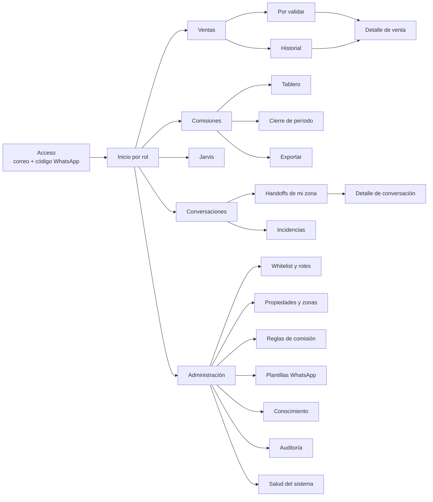

# Diseño del frontend — Panel operativo
`¤frontend-glamping` `¤panel-operativo`

| Campo | Valor |
| :--- | :--- |
| Versión | 0.1.0 (2026-10-30) |
| Decisión | [ADR-0013 — Panel operativo propio](adr/ADR-0013-panel-operativo-propio.md) (aceptado por el propietario el 2026-10-30; revisa la adopción de la UI del CRM del informe §3) |
| Módulo | [`modulos/panel_operativo.md`](modulos/panel_operativo.md) (compuerta, BFF, persistencia, tests) |
| Requisitos | [`PRD.md` §5.11](PRD.md#511-panel-operativo--sala-panel_operativo) (RF-PAN-01..10) |
| Método | BBAP en 2 pasos: boceto libre con inspiración en la ergonomía de plataformas líderes (densidad de datos, espaciado limpio, una acción principal por pantalla) → sellado sin logotipos, nombres comerciales ni CSS/JS propietario de terceros |

## 1. Alcance y usuarios
`¤frontend-alcance`

El panel es la **única interfaz propia del equipo**. Huéspedes y vendedores no lo usan: su interfaz es WhatsApp. Lo usan tres roles, con permisos que no define el panel sino la allowlist de `seguridad`:

| Rol | Entra para | Dispositivo dominante | Lo que nunca ve |
| :--- | :--- | :--- | :--- |
| **Líder comercial** | Validar ventas en el momento, revisar el tablero, preguntar a Jarvis, cerrar el período. | Teléfono (validación), portátil (cierre). | Administración de seguridad; conversaciones de huéspedes salvo que también sea gestor. |
| **Gestor de propiedad** | Atender handoffs e incidencias de **su zona**, devolver conversaciones al asistente. | Teléfono. | Ventas, comisiones, otras zonas. |
| **Administrador** | Whitelist y roles, propiedades y zonas, reglas de comisión, plantillas, conocimiento, auditoría, salud. | Portátil. | Nada: ve todo, y todo lo que hace queda en el audit log. |

Fuera del panel (v0.1): app nativa, modo sin conexión, multi-idioma, edición de documentos de `docs/negocio/` (se editan en el repositorio y se reindexan desde el panel).

`¤frontend-alcance/`

## 2. Principios de diseño
`¤frontend-principios`

1. **Móvil primero.** El caso más frecuente es el líder validando una venta desde el teléfono en segundos. Toda pantalla crítica funciona a 360 px de ancho con una mano.
2. **Una acción principal por pantalla.** Validar, Tomar, Resolver, Cerrar período. El resto es secundario y visualmente subordinado.
3. **Densidad sin ruido.** Tablas y tarjetas compactas, tipografía de sistema, un solo color de acento; el color comunica estado, no decora.
4. **Confianza visible.** Cada venta muestra el texto original del vendedor junto a lo extraído y la confianza; los campos dudosos se marcan y se corrigen en la misma tarjeta antes de validar.
5. **Nada se pierde ni se inventa.** Las acciones son optimistas pero reversibles por el flujo de negocio (rechazo con motivo, anulación con motivo), nunca por «deshacer» silencioso; ante conflicto (otro usuario validó), la tarjeta se recarga y lo dice.
6. **Interfaz purificada.** Ningún rastro `¤`/`¦`, ningún identificador técnico de sala o herramienta, ningún nombre de proveedor en la UI; errores con `mensaje_usuario`, nunca con el detalle técnico.
7. **Sin lógica de negocio en el cliente.** El frontend pinta y pide; el BFF llama compuertas; las reglas viven en las salas.

`¤frontend-principios/`

## 3. Mapa de navegación
`¤frontend-navegacion`



Visibilidad por rol: Líder → Ventas, Comisiones, Jarvis. Gestor → Conversaciones. Administrador → todo. La barra inferior (móvil) o lateral (escritorio) solo muestra las secciones del rol.

`¤frontend-navegacion/`

## 4. Pantallas
`¤frontend-pantallas`

Convención de wireframes: ancho móvil 360 px; `[ ]` botón, `( )` chip de estado, `▤` lista, `…` menú secundario.

### P-01 Acceso
Correo → el BFF busca el número en la whitelist del rol y envía un código de 6 dígitos por WhatsApp (plantilla) → código → sesión. Sin contraseñas que recordar; sin creación de cuentas desde la UI (las crea el administrador).

```
┌──────────────────────────────┐
│  Glamping Imbabura · Panel   │
│                              │
│  Correo                      │
│  [ ana@...               ]   │
│  [ Enviarme el código ]      │
│                              │
│  Te llegará por WhatsApp al  │
│  número registrado.          │
└──────────────────────────────┘
```

### P-02 Inicio por rol
Tarjetas de resumen con la acción principal del rol arriba: Líder → «N ventas por validar» · Gestor → «N conversaciones esperando en tu zona» · Administrador → alertas activas y salud.

### P-03 Ventas · Por validar (pantalla crítica, US-06)

```
┌──────────────────────────────┐
│ ← Ventas        Por validar ▾│
│ Filtros: (Hoy) (Todas) (Juan)│
├──────────────────────────────┤
│ V-2026-0107   hace 4 min     │
│ Juan P. → María López        │
│ Depa Centro · 3 noches       │
│ USD 450,00  · com. est. 45,00│
│ Confianza ●●●●○  (fecha ?)   │
│ "vendí 3 noches depa centro  │
│  a María López, 450, llega   │
│  el 15"                      │
│ [ Validar ]  [ Rechazar ]  … │
├──────────────────────────────┤
│ V-2026-0106   hace 1 h       │
│ …                            │
└──────────────────────────────┘
```

- La tarjeta muestra lo extraído y el texto original. Un campo con confianza baja lleva `?` y se edita tocándolo (hoja inferior con el campo y el texto original resaltado).
- **Validar** confirma en una sola acción si no hay campos dudosos; si los hay, abre la corrección primero. **Rechazar** exige motivo (lista + texto libre).
- Tras validar: la tarjeta se desliza fuera, aparece un aviso «Validada · comisión 45,00 fijada · vendedor notificado». Si el envío al CRM falla, el aviso lo dice y la venta queda marcada «pendiente de publicar» en Historial (no se bloquea al líder).
- Conflicto: si otro usuario validó o rechazó antes, la tarjeta se recarga con el nuevo estado y un aviso.

### P-04 Detalle de venta
Datos completos, comisión (regla y versión aplicadas), estado de publicación en el CRM, enlace a la reserva si existe, y línea de tiempo de transiciones (quién, cuándo, motivo). Acciones según estado y rol: Anular (solo administrador, con motivo).

### P-05 Comisiones · Tablero (US-08)

```
┌────────────────────────────────────────────────────────┐
│ Comisiones · Octubre 2026 ▾        [ Exportar CSV ]    │
│ ┌─────────────┐ ┌─────────────┐ ┌─────────────┐        │
│ │ Ventas      │ │ Com. valid. │ │ Com. pend.  │        │
│ │ USD 12 450  │ │ USD 1 245   │ │ USD 180     │        │
│ └─────────────┘ └─────────────┘ └─────────────┘        │
│ Ventas por mes  ▁▃▅▆█▇          Por propiedad  ▤       │
│ Por vendedor                                            │
│ ▤ Juan P.   8 ventas   USD 3 600   com. 360,00  (2 pend)│
│ ▤ Ana R.    5 ventas   USD 2 250   com. 225,00          │
│ …                                                       │
└────────────────────────────────────────────────────────┘
```

Los totales se calculan en `comisiones` y coinciden al centavo con la exportación (RF-ARM-08). Gráficos sencillos (barras por mes, barras horizontales por vendedor/propiedad); nada de gráficos decorativos.

### P-06 Cierre de período y exportación
Solo líder y administrador. Muestra el resumen previo (ventas, comisiones por vendedor, pendientes de validar que quedarán fuera) y exige confirmación escrita del período («OCT-2026»). Tras cerrar, el período es de solo lectura y la exportación CSV/JSON queda disponible.

### P-07 Jarvis (US del ARM, RF-ARM-09)

```
┌──────────────────────────────┐
│ Jarvis                       │
│ ┌──────────────────────────┐ │
│ │ ¿Cuánto vendió Ana en    │ │
│ │ septiembre?              │ │
│ └──────────────────────────┘ │
│ Ana R. vendió USD 2 250 en   │
│ 5 ventas validadas en        │
│ septiembre 2026.             │
│ ┌──────────────────────────┐ │
│ │ Activa el aviso al       │ │
│ │ vendedor al validar      │ │
│ └──────────────────────────┘ │
│ Voy a activar «aviso al      │
│ validar». ¿Confirmas?        │
│ [ Confirmar ]  [ Cancelar ]  │
│ [ Escribe tu pregunta…     ] │
└──────────────────────────────┘
```

Jarvis responde solo con datos que el rol puede ver; los cambios de configuración muestran qué va a cambiar y piden confirmación explícita; nunca cambia reglas de comisión.

### P-08 Conversaciones · Handoffs de mi zona (US-09, US-10)

```
┌──────────────────────────────┐
│ Conversaciones   Zona Centro▾│
│ Esperando (2) · Mías (1)     │
├──────────────────────────────┤
│ Depa Centro 01 · hace 3 min  │
│ Motivo: pidió hablar con     │
│ alguien                      │
│ Resumen: huésped llega hoy,  │
│ pregunta por parqueo…        │
│ [ Tomar ]                    │
├──────────────────────────────┤
│ Glamping · hace 12 min       │
│ Motivo: incidencia crítica   │
│ [ Tomar ]                    │
└──────────────────────────────┘
```

### P-09 Detalle de conversación
Historial con PII rehidratada **solo** lo necesario para atender (nombre y teléfono del huésped de la reserva; nunca datos de terceros), resumen del asistente, propiedad y reserva. Caja de respuesta (sale por el mismo número de WhatsApp) y botón **Devolver al asistente**. Si la ventana de 24 h cerró, la caja avisa y ofrece la plantilla.

### P-10 Incidencias
Lista por zona con prioridad y estado; detalle con número, descripción, propiedad, reserva, historial; acción **Resolver** con nota (notifica al huésped por plantilla si corresponde).

### P-11 Administración (solo administrador)

| Subpantalla | Contenido | Acción principal | Compuerta |
| :--- | :--- | :--- | :--- |
| Whitelist y roles | Números (enmascarados), rol, sujeto, fecha, quién dio de alta. | Alta/baja con confirmación. | `seguridad` |
| Propiedades y zonas | Propiedades del PMS, zona, gestor principal y respaldo, variante de prompt, activa. | Asignar zona/gestor. | `pms_conector`, `crm_conector` |
| Reglas de comisión | Reglas vigentes e históricas con versión y vigencia. | Nueva versión (nunca edición en sitio). | `comisiones` |
| Plantillas WhatsApp | Nombre, idioma, variables, estado de aprobación en Meta. | Marcar aprobada / solicitar. | `canal_whatsapp` |
| Conocimiento | Documentos indexados, propiedad, dueño, fecha, versión; resultado del último set dorado. | Reindexar. | `conocimiento` |
| Auditoría | Audit log filtrable (actor, acción, propiedad, fecha). | Exportar semana. | `seguridad` |
| Salud del sistema | OP-01..OP-10 en ventana móvil, alertas activas, cola del CRM, última traza. | — | `observabilidad` |

`¤frontend-pantallas/`

## 5. Componentes
`¤frontend-componentes`

| Componente | Uso | Reglas |
| :--- | :--- | :--- |
| `BarraNavegacion` | Inferior en móvil, lateral en ≥ 1024 px. | Solo secciones del rol; indicador numérico de pendientes. |
| `TarjetaVenta` | P-03. | Texto original siempre visible; campos con `?` editables; acciones Validar/Rechazar; estado de publicación. |
| `HojaCorreccion` | Corrección de campos dudosos. | Un campo a la vez; muestra el fragmento del texto original que lo originó. |
| `DialogoMotivo` | Rechazar, anular, resolver. | Motivos predefinidos + texto libre; obligatorio. |
| `ChipEstado` | Estados de venta, incidencia, publicación, handoff. | Color semántico + texto; nunca solo color. |
| `TablaDensa` | Historial, por vendedor, auditoría, whitelist. | Ordenable, paginada (25), columnas fijas en móvil con desplazamiento horizontal. |
| `TarjetaMetrica` | Tablero, salud. | Valor grande, etiqueta, variación vs período anterior. |
| `GraficoBarras` | Ventas por mes, por vendedor, por propiedad. | Un color; valores al pasar o tocar; accesible por tabla alternativa. |
| `ChatJarvis` | P-07. | Burbujas, confirmación explícita para cambios, sin historial persistente más allá de la sesión. |
| `ListaHandoff`, `HiloConversacion` | P-08, P-09. | Mensajes entrantes/salientes diferenciados; aviso de ventana de 24 h. |
| `Aviso` (toast) | Resultado de acciones. | Texto con el efecto real («comisión 45,00 fijada»); error con `mensaje_usuario`. |
| `EstadoVacio`, `EstadoCarga`, `EstadoError` | Toda lista. | Texto breve y acción siguiente; esqueletos en carga. |

`¤frontend-componentes/`

## 6. Sistema visual (tokens)
`¤frontend-tokens`

Boceto inspirado en la ergonomía de paneles de operaciones de referencia (densidad, jerarquía tipográfica clara, un acento); sellado con tokens propios. No se copian logotipos, nombres ni hojas de estilo de terceros.

| Token | Claro | Oscuro | Uso |
| :--- | :--- | :--- | :--- |
| `--fondo` | `#FAFAF9` | `#111311` | fondo de página |
| `--superficie` | `#FFFFFF` | `#1A1D1A` | tarjetas, tablas |
| `--borde` | `#E6E4E0` | `#2A2E2A` | separadores |
| `--texto` | `#1B1F1B` | `#ECEDE9` | texto principal |
| `--texto-secundario` | `#5F665F` | `#A3A89F` | etiquetas, metadatos |
| `--acento` | `#2F6B4F` | `#6FBF8E` | acción principal (verde bosque: identidad del glamping) |
| `--exito` | `#2E7D32` | `#81C784` | validada, resuelta |
| `--aviso` | `#B26A00` | `#FFB74D` | por validar, pendiente de publicar |
| `--error` | `#B3261E` | `#F2B8B5` | rechazada, fallo |
| `--info` | `#1F5F8B` | `#8FC1E3` | handoff, informativo |

- **Tipografía:** pila de sistema (`-apple-system, "Segoe UI", Roboto, "Helvetica Neue", Arial, sans-serif`); escala 12 / 14 / 16 / 20 / 24 / 32 px; números tabulares en montos.
- **Espaciado:** múltiplos de 4 px; tarjetas con relleno 12 px (móvil) y 16 px (escritorio).
- **Radios:** 8 px tarjetas, 6 px botones, 999 px chips. **Sombra:** una sola, suave, solo en hojas y diálogos.
- **Puntos de corte:** 360 (mínimo), 768 (tableta), 1024 (lateral), 1440 (dos columnas en tablero).
- **Iconos:** un set abierto con licencia permisiva (por ejemplo ISC/MIT), trazo 1,5 px, siempre acompañados de texto o `aria-label`.
- **Modo oscuro:** automático por preferencia del sistema; mismos tokens.

`¤frontend-tokens/`

## 7. Estados, accesibilidad, rendimiento, localización
`¤frontend-calidad`

- **Estados:** toda lista tiene carga (esqueleto), vacío (texto + acción), error (mensaje de usuario + reintentar), conflicto (recarga y aviso). Las acciones muestran progreso y deshabilitan el botón hasta la respuesta.
- **Accesibilidad:** WCAG 2.1 AA; contraste ≥ 4,5:1; navegación por teclado completa; foco visible; objetivos táctiles ≥ 44 px; estados nunca solo por color; gráficos con tabla alternativa; `lang="es"`.
- **Rendimiento (presupuesto en 4G, teléfono medio):** LCP ≤ 2,5 s, INP ≤ 200 ms, JS inicial ≤ 200 KB comprimido, sin fuentes web externas.
- **Localización:** español de Ecuador; moneda USD con coma decimal y espacio de miles («USD 12 450,00»); zona horaria America/Guayaquil; fechas relativas («hace 4 min») con fecha completa al pasar o tocar.
- **Sin conexión:** no se soporta; se muestra un aviso y se bloquean las acciones hasta recuperar la red.

`¤frontend-calidad/`

## 8. Contrato del BFF (`/panel/api`)
`¤frontend-bff`

Todas las rutas exigen sesión (cookie `HttpOnly`, `Secure`, `SameSite=Strict`) y cabecera CSRF; cada una pasa por `seguridad.autorizar(rol, accion)` y deja un evento en el audit log. Respuestas JSON con `mensaje_usuario` en los errores.

| Método y ruta | Compuerta → método | Roles |
| :--- | :--- | :--- |
| `POST /sesion/codigo` · `POST /sesion` · `DELETE /sesion` | `panel.iniciar_sesion` / `cerrar_sesion` | todos |
| `GET /ventas?estado=&vendedor=&periodo=&pagina=` | `arm.listar` | líder, admin |
| `GET /ventas/{id}` | `arm.detalle` | líder, admin |
| `POST /ventas/{id}/validar` `{correcciones?}` | `arm.validar` | líder, admin |
| `POST /ventas/{id}/rechazar` `{motivo}` | `arm.rechazar` | líder, admin |
| `POST /ventas/{id}/anular` `{motivo}` | `arm.anular` | admin |
| `GET /comisiones/tablero?periodo=` | `arm.tablero` | líder, admin |
| `POST /comisiones/periodos/{id}/cerrar` `{confirmacion}` | `comisiones.cerrar_periodo` | líder, admin |
| `GET /comisiones/periodos/{id}/exportar?formato=csv\|json` | `comisiones.exportar` | líder, admin |
| `POST /jarvis` `{pregunta, conversacion_id}` · `POST /jarvis/confirmar` | `arm.preguntar_jarvis` / `aplicar_cambio_configuracion` | líder, admin |
| `GET /handoffs` | `panel.handoffs` (filtra zonas de la sesión) | gestor, admin |
| `POST /handoffs/{id}/tomar` · `POST /handoffs/{id}/responder` `{texto}` · `POST /handoffs/{id}/devolver` | `panel.tomar_handoff` / `responder` / `devolver_al_asistente` → `agente`, `canal` | gestor, admin |
| `GET /incidencias` · `POST /incidencias/{id}/resolver` `{nota}` | `pms` u `operaciones` | gestor, admin |
| `GET/POST/DELETE /admin/whitelist` | `seguridad.administrar_whitelist` | admin |
| `GET /admin/propiedades` · `PUT /admin/propiedades/{id}/zona` | `pms.listar_propiedades`, `crm` | admin |
| `GET/POST /admin/reglas-comision` | `comisiones.reglas` / `crear_regla` | admin |
| `GET /admin/plantillas` · `PUT /admin/plantillas/{nombre}` | `canal` | admin |
| `GET /admin/conocimiento` · `POST /admin/conocimiento/reindexar` | `conocimiento.documentos` / `indexar` | admin |
| `GET /admin/auditoria?…` | `seguridad` (lectura del audit log) | admin |
| `GET /admin/salud` | `observabilidad.metricas` / `alertas_activas` | admin |

`¤frontend-bff/`

## 9. Seguridad del panel
`¤frontend-seguridad`

- Acceso solo para números en la whitelist con rol `lider`, `gestor` o `administrador`; código de un solo uso por WhatsApp con 5 intentos y 10 minutos de validez; sesión de 12 h renovable.
- Autorización en el servidor, nunca en el cliente: la UI oculta lo que el rol no puede hacer, pero el BFF rechaza igual con 403.
- PII rehidratada solo en P-09 (atención de huésped) y P-11 whitelist (enmascarada); el resto trabaja con nombres de vendedores y clientes tal como los registró la venta.
- Cabeceras: CSP estricta (sin scripts externos), `X-Frame-Options: DENY`, HSTS en producción.
- Todo `POST`/`PUT`/`DELETE` deja un evento en el audit log con el `usuario_id`.
- Las pruebas e2e verifican que ningún texto renderizado contenga rastros ni nombres de proveedor (`tests/test_interfaz_purificada.py` sobre el build).

`¤frontend-seguridad/`

## 10. Stack técnico (propuesta técnica de ADR-0013, revisable sin cambiar este diseño)
`¤frontend-stack`

| Capa | Elección | Motivo |
| :--- | :--- | :--- |
| UI | React 18 + TypeScript, Vite | Ecosistema amplio, tipado, build rápido; el equipo que construya el proyecto lo conoce. |
| Datos | TanStack Query | Caché, reintentos y estados de carga/error uniformes para todas las listas. |
| Estilos | CSS con variables (tokens de §6); utilidades opcionales | Cero dependencia visual de terceros; modo oscuro por tokens. |
| Gráficos | Recharts | Barras simples, accesibles, sin licencias restrictivas. |
| Servidor | BFF en FastAPI dentro de la sala (`bff_internal.py`), estáticos servidos por la misma app tras el proxy | Un solo despliegue; sin CORS; sesión por cookie. |
| Pruebas | Vitest (componentes), Playwright (e2e sobre `localhost`), `pytest` (BFF) | Encaja con el protocolo de autoevaluación E2E de ZERAG. |

`¤frontend-stack/`

## 11. Métricas de uso del panel
`¤frontend-metricas`

| Métrica | Umbral objetivo | Fuente |
| :--- | :--- | :--- |
| Tiempo desde que una venta entra en *por validar* hasta validada/rechazada (mediana) | ≤ 4 h hábiles | transiciones de `arm_jarvis` |
| Toques necesarios para validar una venta sin campos dudosos | 1 | prueba e2e |
| Tiempo hasta que un gestor toma un handoff (P95) | ≤ 15 min en horario operativo | `handoff.inicio` → `tomado_en` |
| Errores 403 por sesión (indican UI que muestra lo que no debe) | 0 | audit log |
| LCP en P-03 (teléfono medio, 4G) | ≤ 2,5 s | prueba de rendimiento en CI |

`¤frontend-metricas/`

## 12. Entrega por fases
`¤frontend-fases`

| Fase | Pantallas | Sustituye |
| :--- | :--- | :--- |
| 4 | P-01, P-02, P-08, P-09, P-10 (bandeja de handoff e incidencias por zona) | `FakeCRM` como inbox de la fase 4 |
| 5 | P-11 whitelist, auditoría, salud | — |
| 6 | P-03, P-04, P-07 (ventas por validar, detalle, Jarvis) | validación «desde la UI del CRM» |
| 7 | P-05, P-06, P-11 reglas, plantillas, conocimiento, propiedades | visualización del tablero «en el CRM o BI» |
| 8 (condicional, ADR-0010) | Inbox completo de conversaciones de huéspedes (no solo handoffs) | inbox del proveedor |

`¤frontend-fases/`

---

`¤frontend-glamping/`

© 2026 Glamping Imbabura. Diseño original; metodología BBAP de Zero-Regression AI Governance BIAS, © 2026 Juan Carlos Proaño.
