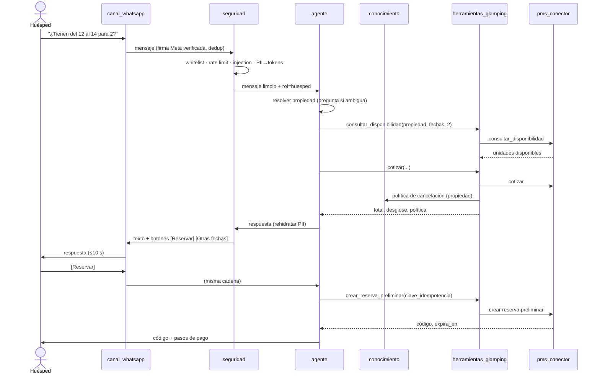
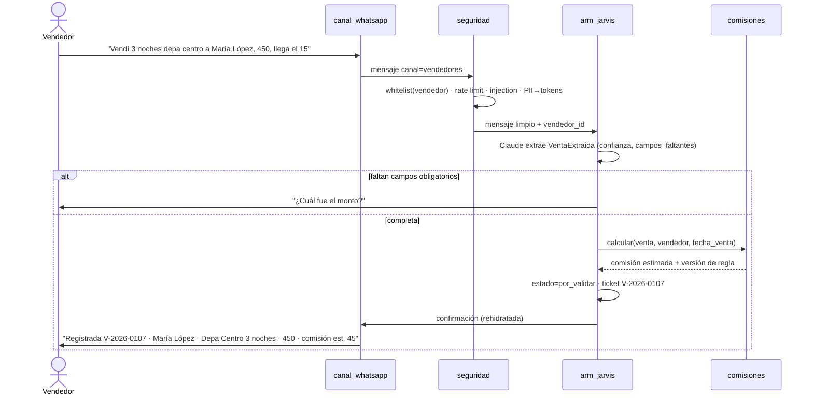
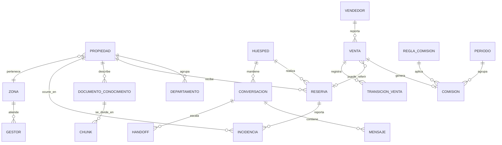

# PRD — Asistente de WhatsApp, ARM y CRM para Glamping Imbabura
`¤prd-glamping`

| Campo | Valor |
| :--- | :--- |
| Versión | 0.1.0 (borrador para revisión del equipo) |
| Fecha | 2026-10-30 |
| Fuente de verdad | [`PROJECT_CONTEXT.md`](PROJECT_CONTEXT.md) (informe maestro). Las referencias «§N» de este PRD apuntan a sus secciones. |
| Arquitectura | [`ARQUITECTURA.md`](ARQUITECTURA.md) |
| Decisiones | [`adr/README.md`](adr/README.md) |
| Catálogo de salas y asignación de requisitos | [`../governance/artefactos/PRD.md`](../governance/artefactos/PRD.md) |
| Diseño detallado | [`modulos/`](modulos/README.md) (un documento por sala: compuerta, tipos, configuración, errores, persistencia, tests) · [`FRONTEND.md`](FRONTEND.md) (panel operativo: pantallas, navegación, componentes, tokens, BFF) |
| Convenciones | `[DECISIÓN PENDIENTE]` marca una elección que el informe deja abierta (§14) y que este PRD **no** resuelve. Cada requisito declara **Construir** o **Adoptar**, su sala ADPA, su rastro `¤` y su árbitro (el test o verificación que lo da por cumplido). |

---

## 1. Visión del producto
`¤prd-vision`

**Qué es.** Un asistente conversacional sobre WhatsApp, con Claude como motor, que atiende a los huéspedes de Glamping Imbabura y de sus futuros departamentos urbanos, ejecuta acciones reales sobre el sistema de reservas (PMS) a través de herramientas MCP, y que incluye un módulo ARM (Agent Relationship Manager, «Jarvis») que convierte las ventas que los vendedores escriben en un grupo de WhatsApp en registros estructurados con comisión calculada, validables por el líder comercial y visibles en un CRM que el equipo no técnico ya sabe usar.

**Para quién.** Seis perfiles (§2.3): huésped potencial, huésped activo, vendedor, líder comercial, gestor de propiedad y administrador.

**Qué problema resuelve.** Hoy una sola ubicación se atiende a mano por WhatsApp. La expansión a departamentos distribuidos por la ciudad multiplica calendarios, precios, instrucciones de check-in, equipos de limpieza y gestores por zona (§2.2): atenderlo a mano no escala y degrada el tiempo de respuesta. En paralelo, las ventas de los vendedores se reportan en texto libre y se transcriben a mano a una planilla o CRM, con errores, demoras y comisiones calculadas tarde.

**Por qué ahora.** Tres condiciones coinciden: (1) la expansión a departamentos está planificada y exige multi-propiedad desde el diseño; (2) Claude con *tool use* y el protocolo MCP permiten que el agente actúe sobre PMS y CRM sin acoplarse a un proveedor; (3) la API oficial de WhatsApp Cloud elimina el riesgo de baneo que hacía inviable automatizar el canal con librerías no oficiales (§9.4).

**Qué lo distingue.** El principio «construir lo que diferencia, adoptar lo que no» (§3): el motor conversacional, el RAG, los conectores, la seguridad, el ARM y las comisiones se construyen en casa y son el activo; la interfaz de CRM, la bandeja de entrada con handoff y el constructor de workflows se adoptan de un proveedor detrás de interfaces abstractas. Si el proveedor cambia, el núcleo sigue operando.

**Cómo se construye.** Bajo la metodología ZERAG: salas ADPA estancas con compuertas `_service.py`, rastros `¤` que enlazan requisito, invariante, tarea, ADR y código, y un arnés físico con Exit Code 0 como único árbitro de «fase completada» ([`PROJECT_CONTEXT.md` Anexo B](PROJECT_CONTEXT.md#anexo-b-proyección-del-informe-sobre-la-metodología-zerag)).

`¤prd-vision/`

---

## 2. Objetivos y métricas de éxito
`¤prd-objetivos`

Convención de plazos: **T0** = inicio de la fase 1 (MVP WhatsApp). **Beta** = fases 0–5 en el PC Ubuntu. **Producción** = stack migrado al servidor propio tras la fase 7. Toda métrica se instrumenta desde el día uno (ver §15.3) aunque su umbral se evalúe más tarde.

### 2.1 Objetivos de negocio

| ID | Objetivo | Métrica | Umbral | Plazo |
| :--- | :--- | :--- | :--- | :--- |
| ON-01 | Operar la expansión a departamentos sin crecer el equipo de atención en proporción. | Conversaciones de huésped atendidas por persona de atención por semana. | ≥ 2× el valor medido en las dos primeras semanas tras T0. | T0 + 180 días. |
| ON-02 | Eliminar la transcripción manual de ventas. | Porcentaje de ventas del período registradas por el ARM (no por digitación). | ≥ 90 %. | 60 días después de cerrar la fase 6. |
| ON-03 | Pagar comisiones con datos validados, no reconstruidos. | Días entre cierre del período y disponibilidad del tablero de comisiones validadas. | ≤ 1 día hábil. | Primer cierre mensual tras la fase 7. |
| ON-04 | Proteger el negocio contable existente. | Incidentes de degradación del flujo contable atribuibles al asistente. | 0. | Permanente, revisado mensualmente. |
| ON-05 | Mantener el canal sin riesgo de suspensión. | Dependencias de librerías no oficiales de WhatsApp en el repositorio. | 0 (árbitro: `tests/test_canal_oficial.py`). | Permanente. |

### 2.2 Objetivos de producto

| ID | Objetivo | Métrica | Umbral | Plazo |
| :--- | :--- | :--- | :--- | :--- |
| OP-01 | Responder rápido. | Latencia P95 desde webhook de Meta hasta envío de la respuesta, conversaciones sin herramienta. | ≤ 5 s. | Medido desde T0; exigido al salir de beta. |
| OP-02 | Responder rápido con acción. | Latencia P95 con una llamada a herramienta PMS. | ≤ 10 s. | Al cerrar la fase 3. |
| OP-03 | Resolver sin humano. | Tasa de conversaciones de huésped cerradas sin handoff. | ≥ 60 % a T0 + 90 d; ≥ 75 % a T0 + 180 d. | Según columna. |
| OP-04 | No inventar. | Fidelidad del RAG sobre el set dorado (`evals/set_dorado.jsonl`, ≥ 100 preguntas con respuesta de referencia). | ≥ 95 % de respuestas fieles; 0 alucinaciones de precio o política. | Al cerrar la fase 2 y en cada CI. |
| OP-05 | Saber decir «no lo sé». | Tasa de abstención correcta ante preguntas fuera del corpus (≥ 30 preguntas trampa en el set dorado). | ≥ 90 %. | Al cerrar la fase 2. |
| OP-06 | Adopción del ARM. | Vendedores activos que reportan por el canal del ARM / vendedores activos. | ≥ 90 %. | 60 días tras la fase 6. |
| OP-07 | Parsing fiable. | Ventas extraídas sin corrección manual del líder / ventas extraídas. | ≥ 95 %. | 30 días tras la fase 6. |
| OP-08 | Confirmación inmediata al vendedor. | Latencia P95 desde el mensaje de venta hasta la confirmación. | ≤ 10 s. | Al cerrar la fase 6. |
| OP-09 | Costo controlado. | Costo de modelo (USD) por conversación de huésped resuelta. | Umbral inicial ≤ 0,10 USD; se recalibra al final de beta con los datos medidos. | Medido desde T0. |
| OP-10 | Seguridad verificable. | Ataques del set de inyección (`evals/inyecciones.jsonl`, ≥ 40 patrones, 4 idiomas) que logran una acción o una revelación no autorizada. | 0. | En cada CI desde la fase 5. |

`¤prd-objetivos/`

---

## 3. Personas y roles
`¤prd-personas`

| Persona | Necesidad principal | Frustración actual | Criterio de éxito | Canal | Permisos (allowlist por acción) |
| :--- | :--- | :--- | :--- | :--- | :--- |
| **Huésped potencial** | Saber si hay disponibilidad, cuánto cuesta, qué hay cerca, y reservar. | Espera horas una respuesta; los precios cambian según quién contesta. | Obtiene disponibilidad y precio exactos en menos de un minuto, cualquier hora, y deja una reserva preliminar. | WhatsApp. | `consultar_disponibilidad`, `cotizar`, `crear_reserva_preliminar`, `solicitar_humano`. |
| **Huésped activo** | Instrucciones de llegada, wifi, normas; reportar un problema. | Las instrucciones dependen del edificio y llegan tarde o incompletas. | Recibe las instrucciones de *su* propiedad el día del check-in sin pedirlas; una incidencia queda registrada con número en el primer mensaje. | WhatsApp. | `obtener_instrucciones_checkin`, `reportar_incidencia`, `solicitar_humano`. |
| **Vendedor** | Reportar una venta en una frase y saber su comisión. | Digitar en formularios; no saber cuánto lleva ganado. | Escribe la venta como siempre, recibe confirmación en segundos y puede preguntar «¿cuánto llevo?». | Grupo de WhatsApp de vendedores (ver supuesto S-01). | `reportar_venta`, `consultar_comision_propia`. No ve comisiones ajenas. |
| **Líder comercial** | Validar ventas y ver comisiones por vendedor y período. | Reconstruir ventas desde el chat a fin de mes. | Valida o rechaza cada venta con una acción; el tablero refleja el cambio al instante. | Panel operativo (ventas, comisiones, Jarvis). | `validar_venta`, `rechazar_venta`, `ver_comisiones_todas`, `exportar_periodo`. |
| **Gestor de propiedad** | Coordinar limpieza, mantenimiento y check-in de su zona. | Conversaciones mezcladas de varias propiedades. | Recibe solo las conversaciones e incidencias de su zona, con la propiedad identificada. | Panel operativo (handoffs e incidencias de su zona). | `ver_conversaciones_zona`, `resolver_incidencia`, `tomar_handoff`. |
| **Administrador** | Configurar propiedades, precios, políticas, whitelist y seguridad. | Cambios dispersos en varios sistemas. | Cambia una política o un precio en un solo lugar y el asistente lo refleja tras reindexar. | Panel operativo (administración: whitelist, propiedades, reglas, plantillas, conocimiento, auditoría, salud). | Todos, más `editar_whitelist`, `editar_tarifas`, `reindexar_conocimiento`. |

`¤prd-personas/`

---

## 4. Casos de uso principales
`¤prd-casos-uso`

| ID | Caso de uso | Actor | Disparador | Resultado | Fase |
| :--- | :--- | :--- | :--- | :--- | :--- |
| CU-01 | Consulta de disponibilidad y reserva por WhatsApp | Huésped potencial | Mensaje con fechas y/o propiedad. | Disponibilidad y precio exactos; reserva preliminar creada en el PMS con código. | 1 (sin PMS) → 3 |
| CU-02 | Check-in autónomo | Huésped activo | Fecha de llegada o pregunta «¿cómo entro?». | Instrucciones de la propiedad correcta (portal, wifi, normas) sin intervención humana. | 4 |
| CU-03 | Reporte de incidencia | Huésped activo | Mensaje que describe un problema. | Incidencia registrada con número, propiedad y prioridad; gestor de la zona notificado. | 3–4 |
| CU-04 | Reporte de venta en el grupo de vendedores | Vendedor | Mensaje de texto libre con una venta. | Venta estructurada en estado *por validar*; confirmación en el canal con número de ticket. | 6 |
| CU-05 | Validación de venta por el líder | Líder comercial | Venta en *por validar*. | Venta *validada* o *rechazada*; comisión fijada; vendedor notificado. | 6–7 |
| CU-06 | Consulta de comisión por el vendedor | Vendedor | Pregunta «¿cuánto llevo?» o similar. | Total validado y pendiente del período, solo del propio vendedor. | 6 |
| CU-07 | Consulta de tablero por el administrador o líder | Administrador / Líder | Abre el tablero en el panel operativo. | Ventas por mes, por vendedor y por propiedad; comisiones validadas y pendientes; exportable. | 7 |
| CU-08 | Handoff a humano por zona | Huésped / Agente | Petición explícita, baja confianza, tema fuera de alcance o incidencia crítica. | Conversación asignada al gestor de la zona en la bandeja del panel operativo; el huésped recibe aviso; el agente deja de responder hasta que se le devuelve. | 4 (bandeja del panel) / 8 (inbox completo, ADR-0010) |
| CU-09 | Administración del sistema | Administrador | Abre Administración en el panel operativo. | Whitelist, propiedades y zonas, reglas de comisión, plantillas, conocimiento, auditoría y salud editables en un solo lugar con auditoría. | 5–7 |

`¤prd-casos-uso/`

---

## 5. Requisitos funcionales por módulo
`¤prd-requisitos`

Formato de cada requisito: **ID — Título.** Descripción. *Criterios de aceptación* (verificables). *Árbitro* (test o verificación). Cabecera del módulo: Construir/Adoptar, sala ADPA, compuerta, rastro, rol.

### 5.1 `whatsapp-gateway` → sala `canal_whatsapp`
`¤canal-whatsapp`

**Construir.** Compuerta `features/canal_whatsapp/canal_whatsapp_service.py`. Rol `¤¤integration-engineer`. Única pieza del sistema que habla con la Cloud API de Meta.

- **RF-GW-01 — Recepción por webhook.** Expone el endpoint de webhook de Meta (verificación `GET` con *verify token* y recepción `POST`). *Criterios:* (a) responde al desafío de verificación con el `hub.challenge`; (b) valida la firma `X-Hub-Signature-256` de cada `POST` y rechaza con 401 la que no coincide; (c) responde 200 en menos de 2 s y procesa el mensaje de forma asíncrona; (d) descarta duplicados por `message_id` (Meta reintenta). *Árbitro:* `tests/canal_whatsapp/test_webhook.py`.
- **RF-GW-02 — Envío de mensajes.** Envía texto, texto con botones de respuesta rápida (hasta 3) y listas (hasta 10 opciones). *Criterios:* (a) cada envío registra el `message_id` devuelto y el estado (`sent`, `delivered`, `read`, `failed`) a medida que llegan los *status updates*; (b) un fallo de la API se reintenta con *backoff* exponencial hasta 3 veces y luego se registra en la bitácora de errores. *Árbitro:* `tests/canal_whatsapp/test_envio.py` con la API simulada.
- **RF-GW-03 — Ventana de 24 horas.** Distingue mensajes de *servicio* (dentro de las 24 h desde el último mensaje del usuario) de mensajes *iniciados por el negocio* (fuera de ventana). *Criterios:* (a) fuera de ventana solo se envían plantillas aprobadas; (b) un intento de enviar texto libre fuera de ventana se rechaza en la compuerta con un error tipado, nunca llega a Meta. *Árbitro:* `tests/canal_whatsapp/test_ventana_24h.py`.
- **RF-GW-04 — Plantillas.** Catálogo de plantillas en `config_canal_whatsapp.yaml` con nombre, idioma, variables y estado de aprobación; como mínimo: `instrucciones_checkin`, `recordatorio_llegada`, `comision_validada`, `incidencia_actualizada`. *Criterios:* (a) un envío de plantilla valida el número y tipo de variables antes de llamar a la API; (b) una plantilla no aprobada no se envía. *Árbitro:* `tests/canal_whatsapp/test_plantillas.py`.
- **RF-GW-05 — Medios.** Recibe imágenes, audio, documentos y ubicación; envía imágenes y documentos. *Criterios:* (a) descarga el medio con el `media_id`, lo guarda en el almacenamiento de archivos (§5.2 del informe) y entrega al agente una referencia, nunca los bytes; (b) el audio se transcribe antes de llegar al agente, o se responde que el canal solo atiende texto (`[DECISIÓN PENDIENTE]` menor, se fija en la fase 1 por costo); (c) los medios de contactos fuera de la whitelist no se descargan. *Árbitro:* `tests/canal_whatsapp/test_medios.py`.
- **RF-GW-06 — Canal del ARM.** Entrega al ARM los mensajes del canal de vendedores (grupo o chat 1:1 según el supuesto S-01) etiquetados con el identificador del canal y del remitente. *Criterios:* (a) un mensaje del canal de vendedores nunca se enruta al agente de huéspedes; (b) un mensaje de huésped nunca llega al ARM. *Árbitro:* `tests/canal_whatsapp/test_enrutamiento_canal.py`.

### 5.2 `agent-core` → sala `agente`
`¤agente-enrutador`

**Construir.** Compuerta `features/agente/agente_service.py`. Rol `¤¤machine-learning-engineer`. Orquesta Claude, el enrutador multi-propiedad y las herramientas MCP.

- **RF-AG-01 — Identificación de la propiedad.** Antes de ejecutar cualquier herramienta, el agente determina la propiedad (glamping o departamento concreto) por código de reserva, nombre, dirección, contexto de la conversación o preguntando. *Criterios:* (a) ninguna herramienta que requiera `propiedad_id` se invoca con el campo vacío; (b) ante ambigüedad entre dos o más propiedades, el agente pregunta con una lista de opciones (RF-GW-02) en lugar de asumir; (c) la propiedad resuelta se persiste en el contexto de la conversación. *Árbitro:* `tests/agente/test_enrutador.py` con 20 conversaciones sintéticas etiquetadas.
- **RF-AG-02 — Carga de prompts por propiedad.** Carga `docs/prompts/system-prompt-enrutador.md` al inicio y, resuelta la propiedad, el prompt de `glamping` o `departamentos` con los datos de la propiedad inyectados. *Criterios:* (a) los prompts se leen de disco en el arranque y se versionan con hash en cada traza; (b) el prompt de departamentos nunca contiene datos de otro departamento distinto del resuelto. *Árbitro:* `tests/agente/test_prompts.py`.
- **RF-AG-03 — Exposición selectiva de herramientas.** Expone a Claude solo las herramientas pertinentes a la propiedad y al rol del interlocutor (allowlist por acción, §3 de este PRD). *Criterios:* (a) un huésped nunca ve herramientas de ventas; (b) un vendedor nunca ve herramientas de reservas; (c) el conjunto expuesto queda registrado en la traza de la llamada. *Árbitro:* `tests/agente/test_allowlist_herramientas.py`.
- **RF-AG-04 — Orquestación de herramientas.** Ejecuta el bucle de *tool use* (llamada → resultado → nueva llamada) con un máximo configurable de iteraciones. *Criterios:* (a) tope por defecto 6 iteraciones; al superarlo el agente responde con un mensaje de escalamiento (CU-08); (b) cada resultado de herramienta pasa por la redacción de PII (RF-SEC-05) antes de volver al modelo; (c) una herramienta que falla devuelve un error tipado y el agente lo comunica sin inventar el resultado. *Árbitro:* `tests/agente/test_bucle_herramientas.py`.
- **RF-AG-05 — Manejo de errores y degradación.** Ante caída de Claude, del PMS o del RAG, el agente degrada de forma explícita. *Criterios:* (a) timeout de modelo configurable (por defecto 30 s) con un mensaje de disculpa y handoff; (b) si el RAG no responde, el agente no responde preguntas de políticas o precios: ofrece handoff; (c) cada degradación se registra con causa en la traza. *Árbitro:* `tests/agente/test_degradacion.py` con fallos inyectados.
- **RF-AG-06 — Memoria de conversación.** Mantiene el historial de la conversación activa (ventana configurable, por defecto los últimos 30 mensajes o 24 h) y lo persiste en PostgreSQL. *Criterios:* (a) un reinicio del contenedor no pierde el contexto de una conversación abierta; (b) el historial se almacena ya redactado de PII. *Árbitro:* `tests/agente/test_memoria.py`.
- **RF-AG-07 — Enrutamiento de modelos y caché semántico.** Preguntas frecuentes de bajo riesgo (horario, ubicación, wifi) pueden responderse desde caché semántico o con un modelo de menor costo; precios, políticas y acciones siempre con el modelo principal. *Criterios:* (a) el caché nunca sirve respuestas que contengan precios o disponibilidad; (b) la decisión de enrutamiento se registra por conversación para calcular OP-09. *Árbitro:* `tests/agente/test_enrutamiento_modelos.py`.

### 5.3 `rag` → sala `conocimiento`
`¤conocimiento-rag`

**Construir.** Compuerta `features/conocimiento/conocimiento_service.py`. Rol `¤¤data-engineer`. pgvector sobre PostgreSQL gestionado (ADR-0002).

- **RF-RAG-01 — Indexación.** `scripts/seed_knowledge.py` indexa todo `docs/negocio/` (Markdown) en pgvector con metadatos `propiedad_id`, `tipo_documento`, `version`, `fecha`. *Criterios:* (a) la indexación es idempotente: re-ejecutar sin cambios no crea duplicados; (b) un documento modificado reemplaza sus chunks anteriores; (c) el proceso termina con Exit Code 0 y un resumen (documentos, chunks, duración). *Árbitro:* `tests/conocimiento/test_indexacion.py`.
- **RF-RAG-02 — Chunking.** Divide por secciones Markdown con tamaño objetivo configurable (por defecto 400–600 tokens, solapamiento 10 %) y conserva el encabezado de la sección como contexto del chunk. *Criterios:* (a) ningún chunk mezcla contenido de dos propiedades; (b) cada chunk conserva la ruta del documento y el encabezado. *Árbitro:* `tests/conocimiento/test_chunking.py`.
- **RF-RAG-03 — Recuperación híbrida.** Búsqueda vectorial (HNSW) combinada con BM25 y filtro obligatorio por `propiedad_id` (o `global`). *Criterios:* (a) P95 de recuperación ≤ 150 ms para un corpus ≤ 50 000 chunks; (b) una consulta con `propiedad_id` nunca devuelve chunks de otra propiedad; (c) devuelve *top-k* configurable (por defecto 6) con puntuación y fuente. *Árbitro:* `tests/conocimiento/test_recuperacion.py`.
- **RF-RAG-04 — Respuesta «no lo sé».** Si la mejor puntuación está bajo el umbral configurable o el modelo no encuentra soporte en los chunks, la respuesta declara que no tiene esa información y ofrece handoff; nunca completa con conocimiento general para precios, políticas o disponibilidad. *Criterios:* OP-05 ≥ 90 % en las preguntas trampa; 0 precios o políticas sin chunk de soporte en el set dorado. *Árbitro:* `scripts/run_evals.py --suite rag`.
- **RF-RAG-05 — Citación interna.** Cada respuesta basada en RAG lleva en la traza (no en el mensaje al huésped) los identificadores de los chunks usados. *Criterios:* el 100 % de las respuestas con RAG tienen ≥ 1 chunk citado en la traza. *Árbitro:* `tests/conocimiento/test_citacion.py`.
- **RF-RAG-06 — Evaluación continua.** El set dorado se ejecuta en CI y en el arnés de sellado; una caída de fidelidad bajo el umbral rompe la verificación. *Criterios:* OP-04. *Árbitro:* `scripts/run_evals.py --suite rag` con Exit Code ≠ 0 bajo umbral.

### 5.4 `pms-connector` → sala `pms_conector`
`¤pms-conector`

**Construir sobre MCP.** Compuerta `features/pms_conector/pms_conector_service.py`. Rol `¤¤integration-engineer`. Proveedor concreto: `[DECISIÓN PENDIENTE]` §14.1 (Kamra / Repull MCP / Hospitable), ADR-0007.

- **RF-PMS-01 — Interfaz abstracta.** `PMSConnector` expone: `listar_propiedades()`, `consultar_disponibilidad(propiedad_id, desde, hasta, huespedes)`, `cotizar(...)`, `crear_reserva_preliminar(...)`, `obtener_reserva(codigo)`, `cancelar_reserva(codigo, motivo)`, `obtener_instrucciones_checkin(propiedad_id)`, `registrar_tarea_housekeeping(...)`. *Criterios:* (a) la compuerta solo expone tipos propios del dominio (`Propiedad`, `Disponibilidad`, `Cotizacion`, `Reserva`), nunca objetos del SDK del proveedor; (b) existe una implementación `FakePMS` en memoria para pruebas y para la fase 1. *Árbitro:* `tests/pms_conector/test_contrato.py` ejecutado contra `FakePMS` y contra la implementación real con *fixtures* grabados.
- **RF-PMS-02 — Implementaciones.** Una implementación por proveedor en archivos privados de la sala (`kamra_internal.py`, `repull_internal.py`, `hospitable_internal.py`); se activa una sola por configuración. *Criterios:* (a) cambiar de proveedor es un cambio en `config_pms_conector.yaml`, sin tocar `agente` ni `herramientas_glamping`; (b) las escrituras están desactivadas por defecto y se habilitan de forma explícita por operación (patrón *read-mostly* del informe §5.4). *Árbitro:* `tests/pms_conector/test_seleccion_proveedor.py`.
- **RF-PMS-03 — Manejo de errores del PMS.** Errores tipados: `PMSNoDisponible`, `PropiedadInexistente`, `FechasInvalidas`, `SinDisponibilidad`, `EscrituraDeshabilitada`. *Criterios:* (a) timeouts configurables (por defecto 8 s) y reintentos solo en lecturas; (b) ninguna escritura se reintenta automáticamente sin clave de idempotencia; (c) cada error llega al agente como mensaje accionable. *Árbitro:* `tests/pms_conector/test_errores.py`.
- **RF-PMS-04 — Sincronización con OTAs.** El conector no habla con Airbnb ni Booking: delega en el PMS o channel manager (§4 del informe). *Criterios:* no existe en el repositorio ningún cliente directo de OTAs. *Árbitro:* `tests/test_sin_clientes_ota.py` (búsqueda en manifiestos e imports).

### 5.5 `crm-connector` → sala `crm_conector`
`¤crm-conector`

**Adoptar el CRM; construir la interfaz.** Compuerta `features/crm_conector/crm_conector_service.py`. Rol `¤¤integration-engineer`. Proveedor: `[DECISIÓN PENDIENTE]` §14.2 (GoHighLevel vs Chatwoot + Attio/HubSpot + n8n), ADR-0008. Lo que aísla la adopción es esta interfaz: `agente` y `arm_jarvis` solo conocen la compuerta.

- **RF-CRM-01 — Interfaz abstracta.** `CRMConnector` con `buscar_contacto(email, telefono)`, `crear_contacto`, `crear_oportunidad`, `actualizar_oportunidad`, `enviar_mensaje(conversacion_id, texto)`, `asignar_conversacion(conversacion_id, agente_id)`, `publicar_venta(venta)` (Inbound Webhook). *Criterios:* (a) tipos propios (`Contacto`, `Oportunidad`, `Mensaje`), sin objetos del SDK; (b) `FakeCRM` en memoria para pruebas. *Árbitro:* `tests/crm_conector/test_contrato.py`.
- **RF-CRM-02 — Implementaciones.** `ghl_internal.py` primero; `chatwoot_internal.py` o `attio_internal.py` sin tocar otras salas. *Criterios:* cambio de proveedor = cambio en `config_crm_conector.yaml`. *Árbitro:* `tests/crm_conector/test_seleccion_proveedor.py`.
- **RF-CRM-03 — Publicación de venta firmada e idempotente.** `publicar_venta` envía al Inbound Webhook el payload de §7.1 firmado con HMAC-SHA256 sobre el cuerpo canónico y la cabecera de fecha. *Criterios:* (a) la firma se calcula con un secreto que no está en el repositorio; (b) repetir la publicación de la misma `venta_id` no crea un segundo contacto ni una segunda oportunidad (upsert por `venta_id` y por teléfono); (c) se registra el `status` HTTP y el cuerpo de respuesta. *Árbitro:* `tests/crm_conector/test_publicar_venta.py` con un receptor simulado que verifica la firma.
- **RF-CRM-04 — Manejo de errores del CRM.** Errores tipados: `CRMNoDisponible`, `ContactoDuplicado`, `WebhookRechazado`, `LimiteDeTasa`. *Criterios:* (a) las publicaciones de venta fallidas entran en una cola de reintento persistente con *backoff* y se reintentan hasta 24 h; (b) una venta nunca se pierde: queda en el ARM como *validada / no publicada* hasta que el CRM la acepta. *Árbitro:* `tests/crm_conector/test_cola_reintentos.py`.
- **RF-CRM-05 — Consulta desde el agente vía MCP.** El agente puede buscar contacto y crear oportunidad a través de las herramientas MCP (RF-MCP-07) que internamente llaman a esta compuerta, nunca al MCP de comunidad del proveedor de forma directa. *Criterios:* no hay imports del MCP de comunidad fuera de `features/crm_conector/`. *Árbitro:* `adpa_linter` + `tests/crm_conector/test_confinamiento.py`.

### 5.6 `arm-jarvis` → sala `arm_jarvis`
`¤arm-jarvis`

**Construir** (ADR-0005). Compuerta `features/arm_jarvis/arm_jarvis_service.py`. Rol `¤¤backend-developer`. Referencia funcional: flujo del video de @santaia.lab (§6.3).

- **RF-ARM-01 — Lectura del canal de vendedores.** Recibe de `canal_whatsapp` cada mensaje del canal de vendedores con remitente, hora y texto. *Criterios:* (a) solo procesa remitentes registrados como vendedores en la whitelist (RF-SEC-01); los demás se registran y descartan; (b) el supuesto S-01 (lectura de grupo con la API oficial) se valida antes de la fase 6; si no se cumple, el canal es el chat 1:1 de cada vendedor con el número del negocio sin cambiar este requisito. *Árbitro:* `tests/arm_jarvis/test_ingesta.py`.
- **RF-ARM-02 — Extracción estructurada.** Claude extrae de texto libre una `VentaExtraida` con `cliente`, `telefono_cliente`, `producto` (propiedad + noches o paquete), `monto`, `moneda`, `fecha_venta`, `vendedor_id`, `confianza` y `campos_faltantes`. *Criterios:* (a) ≥ 95 % de extracciones correctas sobre `evals/ventas.jsonl` (≥ 60 mensajes reales anonimizados, incluidos mensajes con errores de tipeo, montos con y sin separadores y fechas relativas); (b) si falta un campo obligatorio (`monto`, `producto`), el ARM pregunta al vendedor por el campo exacto en lugar de registrar; (c) un mensaje que no es una venta (saludo, pregunta) no genera registro. *Árbitro:* `scripts/run_evals.py --suite ventas`.
- **RF-ARM-03 — Estados de la venta.** Máquina de estados: `por_validar` → `validada` | `rechazada`; `validada` → `publicada` (en CRM) | `no_publicada` (cola). *Criterios:* (a) toda transición registra quién, cuándo y motivo; (b) no existe transición desde `rechazada` ni desde `publicada` salvo `anulada` por el administrador con motivo; (c) la comisión solo se fija al pasar a `validada`. *Árbitro:* `tests/arm_jarvis/test_estados.py`.
- **RF-ARM-04 — Cálculo de comisión.** Invoca `comisiones_service` (RF-COM-01) con la venta y el vendedor; guarda monto, porcentaje aplicado y versión de la regla. *Criterios:* (a) el cálculo es reproducible: misma venta + misma versión de regla = misma comisión; (b) un cambio de regla no altera comisiones ya validadas. *Árbitro:* `tests/arm_jarvis/test_comision.py`.
- **RF-ARM-05 — Confirmación y ticket numerado.** Al registrar la venta, responde en el canal con un ticket `V-AAAA-NNNN` y el resumen extraído. *Criterios:* (a) P95 ≤ 10 s (OP-08); (b) la numeración es secuencial por año y sin huecos ni duplicados bajo concurrencia; (c) el texto no contiene rastros `¤`/`¦`. *Árbitro:* `tests/arm_jarvis/test_ticket.py` (incluye prueba de concurrencia).
- **RF-ARM-06 — Notificación al vendedor al validar.** Al pasar a `validada` o `rechazada`, notifica al vendedor por WhatsApp su comisión o el motivo del rechazo, usando plantilla si está fuera de la ventana de 24 h (RF-GW-03). *Criterios:* (a) la notificación va al vendedor en privado, nunca al grupo; (b) un fallo de envío se reintenta y queda visible en el tablero. *Árbitro:* `tests/arm_jarvis/test_notificacion.py`.
- **RF-ARM-07 — Consulta de comisión propia.** Un vendedor pregunta por su comisión y recibe el total validado y el pendiente del período en curso, solo suyo. *Criterios:* (a) ante una pregunta por la comisión de otro vendedor, responde que solo informa la propia; (b) la consulta queda en el audit log. *Árbitro:* `tests/arm_jarvis/test_consulta_comision.py`.
- **RF-ARM-08 — Tablero.** Datos agregados: ventas por mes, por vendedor, por propiedad; comisiones validadas y pendientes; exportación CSV por período. *Criterios:* (a) los totales del tablero coinciden al centavo con la suma de ventas `validadas` del período; (b) la exportación reproduce exactamente las filas del tablero. Visualización: `[DECISIÓN PENDIENTE]` §14.3 (en el CRM o en BI externo); el cálculo siempre es propio. *Árbitro:* `tests/arm_jarvis/test_tablero.py`.
- **RF-ARM-09 — Asistente «Jarvis» para el líder.** El líder puede preguntar en lenguaje natural sobre los datos del ARM («¿cuánto vendió X en septiembre?») y pedir cambios de configuración acotados (p. ej. activar la notificación al validar). *Criterios:* (a) solo responde con datos a los que el rol tiene acceso; (b) los cambios de configuración se aplican sobre `config_arm_jarvis.yaml` con registro de quién y cuándo, y requieren confirmación explícita; (c) no ejecuta cambios de regla de comisión (reservado al administrador). *Árbitro:* `tests/arm_jarvis/test_asistente_lider.py`.

### 5.7 `commissions` → sala `comisiones`
`¤comisiones`

**Construir** (recomendación §14.3; sistema de registro `[DECISIÓN PENDIENTE]`, ADR-0009). Compuerta `features/comisiones/comisiones_service.py`. Rol `¤¤backend-developer`.

- **RF-COM-01 — Reglas versionadas.** Reglas de comisión por vendedor, producto/propiedad y período, con porcentaje o monto fijo, escalones por volumen y vigencia. *Criterios:* (a) cada regla tiene `version`, `vigente_desde`, `vigente_hasta`; (b) `calcular(venta, vendedor, fecha)` elige la regla vigente a la fecha de la venta, no a la fecha del cálculo. *Árbitro:* `tests/comisiones/test_reglas.py`.
- **RF-COM-02 — Cierre de período.** Un período (mes por defecto) se cierra y queda inmutable; las correcciones posteriores generan ajustes en el período siguiente. *Criterios:* (a) no se puede modificar una comisión de un período cerrado; (b) el cierre produce un resumen por vendedor con total, número de ventas y ajustes. *Árbitro:* `tests/comisiones/test_cierre_periodo.py`.
- **RF-COM-03 — Exportación.** Exporta el período en CSV y JSON con esquema documentado. *Criterios:* el archivo exportado valida contra `features/comisiones/esquema_exportacion.json`. *Árbitro:* `tests/comisiones/test_exportacion.py`.

### 5.8 `security` → sala `seguridad`
`¤seguridad-canal`

**Construir.** Compuerta `features/seguridad/seguridad_service.py`. Rol `¤¤security-engineer`. Todo mensaje entrante atraviesa esta sala antes del agente o del ARM; toda salida la atraviesa antes del gateway.

- **RF-SEC-01 — Whitelist de contactos.** Lista de números autorizados por rol (`huesped`, `vendedor`, `lider`, `gestor`, `administrador`); los huéspedes se incorporan automáticamente al existir una reserva o una conversación iniciada por ellos, según política configurable. *Criterios:* (a) un mensaje de un número no autorizado se registra (hash del número, hora) y se descarta sin respuesta; (b) la whitelist se edita solo por el administrador y cada cambio queda en el audit log. *Árbitro:* `tests/seguridad/test_whitelist.py`.
- **RF-SEC-02 — Allowlist por acción.** Mapa rol → acciones permitidas (§3). *Criterios:* (a) la compuerta rechaza con `AccionNoAutorizada` cualquier herramienta fuera del mapa, aunque el modelo la solicite; (b) el mapa vive en `config_seguridad.yaml` y está cubierto por un test que enumera cada rol. *Árbitro:* `tests/seguridad/test_allowlist.py`.
- **RF-SEC-03 — Rate limiting no anulable.** Límites por remitente: 2 mensajes/s, 30/min, tope diario configurable (por defecto 300); por sistema: tope diario de llamadas al modelo. *Criterios:* (a) al superar el límite, los mensajes se encolan o descartan según configuración y se avisa una sola vez al remitente; (b) ningún rol ni configuración desactiva el límite por remitente. *Árbitro:* `tests/seguridad/test_rate_limit.py`.
- **RF-SEC-04 — Filtro de prompt injection.** ≥ 40 patrones en español, inglés, portugués y francés, más heurísticas (petición de ignorar instrucciones, de revelar el prompt, de actuar como otro rol). *Criterios:* (a) OP-10 = 0 ataques exitosos sobre `evals/inyecciones.jsonl`; (b) un mensaje marcado se responde con un texto neutro, se registra y, si se repite 3 veces, se escala a humano; (c) tasa de falsos positivos ≤ 2 % sobre el set de conversaciones legítimas. *Árbitro:* `scripts/run_evals.py --suite inyecciones`.
- **RF-SEC-05 — Redacción de PII.** Tokeniza nombres, teléfonos, correos, documentos de identidad y tarjetas antes de cada llamada al modelo y rehidrata en la respuesta. *Criterios:* (a) ningún número de teléfono ni documento aparece en los *payloads* enviados al modelo (test con captura del cliente HTTP); (b) la rehidratación restituye exactamente el valor original; (c) el historial persistido (RF-AG-06) contiene los tokens, no los valores. *Árbitro:* `tests/seguridad/test_pii.py`.
- **RF-SEC-06 — Audit log.** Registro append-only de cada acción (herramienta, rol, remitente tokenizado, propiedad, resultado, hash del prompt) y de cada cambio de configuración. *Criterios:* (a) el log no se puede modificar desde la aplicación (rol de base de datos solo `INSERT`); (b) existe un informe semanal exportable para revisión manual. *Árbitro:* `tests/seguridad/test_audit_log.py`.
- **RF-SEC-07 — Row-Level Security.** Si la base de datos aloja datos de más de una propiedad o de terceros, se activa RLS por `propiedad_id` con rol de aplicación `NOBYPASSRLS`. *Criterios:* una consulta con el rol de aplicación y `propiedad_id` A no devuelve filas de B. *Árbitro:* `tests/seguridad/test_rls.py` contra PostgreSQL real en CI.

### 5.9 `observability` → sala `observabilidad`
`¤observabilidad`

**Construir.** Compuerta `features/observabilidad/observabilidad_service.py`. Rol `¤¤devops-engineer`.

- **RF-OBS-01 — Logs estructurados.** JSON por línea con `conversacion_id`, `propiedad_id`, `rol`, `sala`, `evento`, `duracion_ms`, sin PII en claro. *Criterios:* (a) un test valida que ningún log contiene patrones de teléfono o correo; (b) los logs van a volúmenes separados del flujo contable (§9.2). *Árbitro:* `tests/observabilidad/test_logs.py`.
- **RF-OBS-02 — Trazas.** Una traza por mensaje entrante con *spans* por sala (seguridad, agente, RAG, PMS, CRM, gateway) y por llamada al modelo (tokens de entrada/salida, modelo, costo estimado). *Criterios:* (a) el 100 % de los mensajes entrantes generan una traza; (b) OP-01, OP-02, OP-08 y OP-09 se calculan a partir de las trazas sin instrumentación adicional. *Árbitro:* `tests/observabilidad/test_trazas.py`.
- **RF-OBS-03 — Evaluaciones en CI y en el arnés.** `scripts/run_evals.py` ejecuta los sets `rag`, `ventas`, `inyecciones` y `enrutador` y falla con Exit Code ≠ 0 bajo umbral. *Criterios:* los umbrales viven en `config_observabilidad.yaml` y coinciden con los de este PRD. *Árbitro:* el propio script dentro de `ejecutar_arnes_glamping.bat`.
- **RF-OBS-04 — Alertas.** Alertas por: webhook sin mensajes en 2 h en horario operativo, tasa de errores > 5 % en 15 min, cola de publicaciones al CRM > 10 elementos, costo diario > umbral. *Criterios:* cada alerta tiene un test que la dispara con datos sintéticos. *Árbitro:* `tests/observabilidad/test_alertas.py`.

### 5.10 `mcp-servers/glamping-tools` → sala `herramientas_glamping`
`¤herramientas-mcp`

**Construir.** Compuerta `features/herramientas_glamping/herramientas_glamping_service.py`; `server.py` es el ejecutable del servidor MCP y solo importa su propia compuerta. Rol `¤¤backend-developer`. Cada herramienta valida su entrada con un esquema JSON, llama a la compuerta de la sala dueña del dato y devuelve una salida tipada. Ninguna herramienta importa lógica privada de otra sala.

| Herramienta | Entrada (esquema) | Salida | Sala invocada | Roles |
| :--- | :--- | :--- | :--- | :--- |
| **RF-MCP-01** `consultar_disponibilidad` | `{propiedad_id: str, desde: date, hasta: date, huespedes: int ≥ 1}` | `{disponible: bool, unidades: [{unidad_id, nombre, capacidad}], motivo?: str}` | `pms_conector` | huésped |
| **RF-MCP-02** `cotizar` | `{propiedad_id, unidad_id, desde, hasta, huespedes}` | `{total: decimal, moneda: str, desglose: [{concepto, monto}], politica_cancelacion_id: str}` | `pms_conector` + `conocimiento` | huésped |
| **RF-MCP-03** `crear_reserva_preliminar` | `{propiedad_id, unidad_id, desde, hasta, huespedes, nombre_token, telefono_token, clave_idempotencia: uuid}` | `{codigo_reserva: str, estado: "preliminar", expira_en: datetime}` | `pms_conector` | huésped |
| **RF-MCP-04** `obtener_instrucciones_checkin` | `{codigo_reserva: str}` | `{propiedad, direccion, hora_checkin, acceso: [{paso}], wifi: {red, clave}, normas: [str], contacto_emergencia}` | `pms_conector` + `conocimiento` | huésped activo |
| **RF-MCP-05** `reportar_incidencia` | `{codigo_reserva?, propiedad_id, descripcion: str, categoria: enum, prioridad: enum}` | `{incidencia_id: "I-AAAA-NNNN", gestor_asignado: str, eta_respuesta: str}` | `pms_conector` u `operaciones` (registro) + `crm_conector` (notificación al gestor) | huésped activo |
| **RF-MCP-06** `solicitar_humano` | `{conversacion_id, propiedad_id, motivo: enum, resumen: str}` | `{asignado_a: str, canal: "inbox", tiempo_estimado: str}` | `crm_conector` (inbox) | huésped, vendedor |
| **RF-MCP-07** `buscar_contacto_crm` / `crear_oportunidad_crm` | `{telefono_token?, email_token?}` / `{contacto_id, propiedad_id, etapa, monto?}` | `Contacto` / `Oportunidad` | `crm_conector` | agente (interno) |
| **RF-MCP-08** `registrar_venta` | `{vendedor_id, texto_original, venta: VentaExtraida}` | `{ticket: "V-AAAA-NNNN", estado: "por_validar", comision_estimada}` | `arm_jarvis` | vendedor (vía ARM) |
| **RF-MCP-09** `consultar_comision_propia` | `{vendedor_id, periodo?: "AAAA-MM"}` | `{validada: decimal, pendiente: decimal, ventas: int, periodo}` | `arm_jarvis` + `comisiones` | vendedor |

*Criterios comunes:* (a) cada herramienta rechaza entradas que no validan contra su esquema con un error legible; (b) cada herramienta pasa por `seguridad_service.autorizar(rol, herramienta)` antes de ejecutarse; (c) cada herramienta tiene un test de contrato contra las implementaciones `Fake*`; (d) la lista de herramientas expuestas por conversación la decide `agente` (RF-AG-03). *Árbitro:* `tests/herramientas_glamping/test_contratos.py`. Nota sobre RF-MCP-05: la incidencia se registra en `pms_conector` si el PMS elegido cubre housekeeping y mantenimiento; si no lo cubre, nace en la fase 3 una sala `operaciones` con su compuerta `operaciones_service.py` como dueña de la entidad Incidencia. Lo decide ADR-0007 junto con el PMS.

### 5.11 Panel operativo → sala `panel_operativo`
`¤panel-operativo`

**Construir** ([ADR-0013](adr/ADR-0013-panel-operativo-propio.md), que revisa la adopción de la UI del CRM del informe §3). Compuerta `features/panel_operativo/panel_operativo_service.py`; BFF y frontend privados de la sala. Rol `¤¤frontend-developer`. Diseño de pantallas, navegación, componentes y tokens en [`FRONTEND.md`](FRONTEND.md); módulo en [`modulos/panel_operativo.md`](modulos/panel_operativo.md). El panel no contiene lógica de negocio: cada acción invoca la compuerta de la sala dueña tras `seguridad.autorizar`.

- **RF-PAN-01 — Acceso y sesión.** Acceso por correo más código de un solo uso enviado por WhatsApp al número en whitelist con rol `lider`, `gestor` o `administrador`. *Criterios:* (a) código de 6 dígitos, 10 min de validez, 5 intentos; (b) sesión en cookie `HttpOnly`/`Secure`/`SameSite=Strict` de 12 h con CSRF; (c) un número fuera de whitelist no recibe código y el intento queda en el audit log. *Árbitro:* `tests/panel_operativo/test_sesiones.py`.
- **RF-PAN-02 — Bandeja de ventas por validar.** Lista de ventas `por_validar` con texto original, campos extraídos, confianza, campos dudosos marcados, comisión estimada; acciones Validar, Rechazar (motivo obligatorio) y corrección de campos antes de validar. *Criterios:* (a) una venta sin campos dudosos se valida con una sola acción (US-06); (b) la corrección muestra el fragmento del texto original que originó el campo; (c) si otro usuario cambió el estado antes, la tarjeta se recarga y lo informa (conflicto), sin doble transición; (d) el resultado muestra la comisión fijada y el estado de notificación y publicación. *Árbitro:* `tests/panel_operativo/test_bff_ventas.py`, `tests/e2e/test_validar_venta.py`.
- **RF-PAN-03 — Detalle de venta.** Datos completos, regla y versión de comisión, estado de publicación en el CRM, reserva vinculada, línea de tiempo de transiciones (actor, hora, motivo); anulación solo para administrador con motivo. *Criterios:* la línea de tiempo coincide con `arm_jarvis.detalle`. *Árbitro:* `tests/panel_operativo/test_bff_ventas.py`.
- **RF-PAN-04 — Tablero de ventas y comisiones.** Ventas por mes, por vendedor y por propiedad; comisiones validadas y pendientes; filtro por período. *Criterios:* (a) totales idénticos al centavo a la exportación del mismo período (RF-ARM-08); (b) los gráficos tienen tabla alternativa accesible. *Árbitro:* `tests/panel_operativo/test_bff_comisiones.py`, `tests/e2e/test_tablero.py`.
- **RF-PAN-05 — Cierre de período y exportación.** Resumen previo, confirmación escrita del período, cierre inmutable, exportación CSV/JSON. *Criterios:* (a) tras el cierre, las acciones de edición desaparecen y el BFF responde 409 a cualquier modificación; (b) la exportación valida contra `esquema_exportacion.json`. *Árbitro:* `tests/panel_operativo/test_bff_comisiones.py`.
- **RF-PAN-06 — Jarvis.** Chat con el asistente del ARM (RF-ARM-09). *Criterios:* (a) solo responde datos del alcance del rol; (b) todo cambio de configuración muestra qué cambiará y exige confirmación explícita; (c) sin historial persistente más allá de la sesión. *Árbitro:* `tests/panel_operativo/test_bff_jarvis.py`.
- **RF-PAN-07 — Handoffs por zona.** Bandeja con conversaciones en handoff de las zonas del usuario; Tomar, Responder (sale por el número de WhatsApp del negocio), Devolver al asistente. *Criterios:* (a) un gestor no ve ni puede actuar sobre otras zonas (403); (b) al tomar, el agente queda en silencio; al devolver, se reanuda; (c) fuera de la ventana de 24 h la respuesta se ofrece como plantilla; (d) la PII rehidratada se limita al huésped de la reserva. *Árbitro:* `tests/panel_operativo/test_bff_handoff.py`, `tests/e2e/test_handoff_zona.py`.
- **RF-PAN-08 — Incidencias.** Lista y detalle por zona con prioridad y estado; Resolver con nota. *Criterios:* resolver notifica al huésped (plantilla si aplica) y registra actor y hora. *Árbitro:* `tests/panel_operativo/test_bff_handoff.py`.
- **RF-PAN-09 — Administración.** Whitelist y roles, propiedades y zonas (gestor principal y respaldo), reglas de comisión (nueva versión, nunca edición en sitio), plantillas de WhatsApp (estado de aprobación), conocimiento (documentos y reindexar), auditoría filtrable y exportable, salud del sistema (OP-01..10, alertas, cola del CRM). *Criterios:* (a) solo `administrador`; (b) cada cambio deja evento en el audit log con `usuario_id`; (c) reindexar devuelve el resumen y el resultado del set dorado. *Árbitro:* `tests/panel_operativo/test_bff_admin.py`.
- **RF-PAN-10 — Calidad de la interfaz.** Móvil primero (360 px), WCAG 2.1 AA, LCP ≤ 2,5 s e INP ≤ 200 ms en 4G con teléfono medio, JS inicial ≤ 200 KB comprimido, español de Ecuador, interfaz purificada. *Criterios:* (a) auditoría de accesibilidad automatizada sin errores críticos; (b) presupuesto de rendimiento medido en CI; (c) 0 rastros ni nombres de proveedor en el build. *Árbitro:* `tests/e2e/test_calidad_ui.py`, `tests/test_interfaz_purificada.py`.

`¤prd-requisitos/`

---

## 6. Requisitos no funcionales
`¤prd-rnf`

| ID | Categoría | Requisito | Métrica y umbral | Cómo se mide | Fase |
| :--- | :--- | :--- | :--- | :--- | :--- |
| RNF-01 | Rendimiento | Respuesta del agente sin herramientas. | P95 ≤ 5 s, P50 ≤ 3 s. | Trazas (RF-OBS-02), ventana móvil de 7 días. | 1 |
| RNF-02 | Rendimiento | Respuesta con una herramienta PMS. | P95 ≤ 10 s. | Trazas. | 3 |
| RNF-03 | Rendimiento | Confirmación del ARM al vendedor. | P95 ≤ 10 s. | Trazas. | 6 |
| RNF-04 | Rendimiento | Recuperación RAG. | P95 ≤ 150 ms con ≤ 50 000 chunks. | Benchmark en CI. | 2 |
| RNF-05 | Disponibilidad | Gateway y agente. | ≥ 99,5 % mensual en producción (medido, no exigido, en beta). | Sondeo externo cada minuto al endpoint de salud. | 5 |
| RNF-06 | Escalabilidad | Propiedades y concurrencia. | 1 glamping + 20 departamentos; 50 conversaciones concurrentes; 200 mensajes/min pico sin superar RNF-01. | Prueba de carga en el arnés de la fase 5. | 5 |
| RNF-07 | Seguridad | Capas de §10 del informe. | Whitelist, allowlist, rate limit, injection filter, PII redaction y audit log activos y con test en verde; 0 ataques exitosos (OP-10). | `scripts/run_evals.py --suite inyecciones` + tests de `seguridad`. | 5 |
| RNF-08 | Seguridad | Secretos. | 0 secretos en el repositorio. | Escáner de secretos en el arnés y pre-commit. | 0 |
| RNF-09 | Seguridad | Webhook del CRM. | 100 % de publicaciones firmadas HMAC-SHA256; 0 duplicados por `venta_id`. | `tests/crm_conector/test_publicar_venta.py`. | 7 |
| RNF-10 | Aislamiento | Servidor contable. | 0 rutas de red desde `agent-net` a servicios contables; límites de CPU/RAM por contenedor definidos. | Test de red en el arnés de despliegue (`docker compose config` + prueba de conexión negativa). | 5 |
| RNF-11 | Mantenibilidad | Confinamiento ADPA. | 0 imports laterales entre salas; 0 huellas `¦` en código sellado. | `adpa_linter`, `huellas_linter`. | 0 |
| RNF-12 | Mantenibilidad | Cobertura. | ≥ 80 % de líneas por sala; 100 % de las herramientas MCP con test de contrato. | `pytest --cov` en el arnés. | 1 |
| RNF-13 | Observabilidad | Trazabilidad. | 100 % de mensajes entrantes con traza; 100 % de acciones en el audit log. | `tests/observabilidad`, `tests/seguridad/test_audit_log.py`. | 5 |
| RNF-14 | Portabilidad | Beta → producción. | El mismo `compose.yaml` + `compose.production.yaml` levanta el stack en el PC Ubuntu y en el servidor; la diferencia es solo el archivo de sobrescritura y `.env`. | `docker compose -f compose.yaml -f compose.production.yaml config` válido en CI; prueba de arranque en ambos. | 0, 5 |
| RNF-15 | Durabilidad | Datos críticos. | pgvector y archivos en nube gestionada con PITR ≥ 7 días; backup externo del PC beta probado (restauración) al menos una vez por fase. | Registro de restauraciones en `governance/artefactos/`. | 0 |
| RNF-16 | Costo | Modelo. | ≤ 0,10 USD por conversación resuelta (umbral inicial, recalibrar al final de beta). | Trazas con tokens y precio. | 1 |
| RNF-17 | Privacidad | Datos personales. | 0 PII en claro en logs, trazas, historial persistido y *payloads* al modelo. | `tests/seguridad/test_pii.py`, `tests/observabilidad/test_logs.py`. | 5 |
| RNF-18 | Cumplimiento | Residencia de datos. | `[DECISIÓN PENDIENTE]` §14.6: si Ecuador exige on-prem para algún dato, ese dato no sale del servidor propio. | Inventario de datos por ubicación en ADR-0012. | antes de 2 |

`¤prd-rnf/`

---

## 7. User stories con criterios de aceptación
`¤prd-user-stories`

Formato: Como [rol], quiero [acción] para [beneficio]. Criterios en Given/When/Then.

**US-01 (CU-01) — Como huésped potencial, quiero preguntar por fechas y recibir disponibilidad y precio exactos para decidir sin esperar a una persona.**
- Given una propiedad resuelta y fechas válidas, When pregunto «¿tienen del 12 al 14 de diciembre para 2?», Then recibo en ≤ 10 s si hay disponibilidad, el precio total con desglose y la política de cancelación, obtenidos del PMS y del RAG, no del conocimiento general del modelo.
- Given que no hay disponibilidad, When pregunto, Then recibo el motivo y, si existen, hasta 3 alternativas de fechas o unidades.
- Given que el PMS no responde, When pregunto, Then el agente lo dice, no inventa disponibilidad y ofrece pasar con una persona.

**US-02 (CU-01) — Como huésped potencial, quiero dejar una reserva preliminar desde WhatsApp para asegurar las fechas mientras pago.**
- Given disponibilidad confirmada, When confirmo «resérvalo», Then se crea una reserva `preliminar` con código, fecha de expiración y mis datos tokenizados, y recibo el código y los pasos de pago.
- Given que ya existe una reserva con la misma clave de idempotencia, When el agente reintenta, Then no se crea una segunda reserva.

**US-03 (CU-02) — Como huésped activo, quiero recibir las instrucciones de check-in de mi propiedad para entrar sin llamar a nadie.**
- Given una reserva confirmada para hoy en el departamento X, When llega la hora configurada (o pregunto «¿cómo entro?»), Then recibo la dirección, el acceso paso a paso, el wifi y las normas **de X**, y ningún dato de otra propiedad.
- Given que estoy fuera de la ventana de 24 h, When el sistema inicia el envío, Then usa la plantilla aprobada `instrucciones_checkin`.

**US-04 (CU-03) — Como huésped activo, quiero reportar un problema y saber que quedó registrado para no repetirlo a varias personas.**
- Given una conversación con propiedad resuelta, When escribo «no hay agua caliente», Then recibo un número `I-AAAA-NNNN`, la prioridad asignada y un tiempo estimado de respuesta, y el gestor de la zona recibe la incidencia con el número.
- Given una incidencia de prioridad crítica (seguridad, acceso), When se registra, Then la conversación pasa a handoff humano (US-09) de inmediato.

**US-05 (CU-04) — Como vendedor, quiero escribir la venta como siempre y que quede registrada para no digitar nada.**
- Given que soy un vendedor en la whitelist, When escribo «vendí 3 noches en el depa del centro a María López, 450, llega el 15», Then en ≤ 10 s recibo el ticket `V-AAAA-NNNN` con cliente, producto, monto, fecha y comisión estimada, y la venta queda en `por_validar`.
- Given que omito el monto, When escribo la venta, Then el ARM me pregunta solo por el monto y no registra hasta tenerlo.
- Given que escribo un saludo o una pregunta, When el ARM lo lee, Then no crea ninguna venta.

**US-06 (CU-05) — Como líder comercial, quiero validar o rechazar cada venta con una acción para que la comisión quede fijada con datos correctos.**
- Given una venta en `por_validar`, When la valido, Then pasa a `validada`, la comisión se fija con la regla vigente a la fecha de la venta, el vendedor recibe la notificación con su comisión y la venta se publica en el CRM firmada e idempotente.
- Given una venta en `por_validar`, When la rechazo con motivo, Then pasa a `rechazada`, no genera comisión y el vendedor recibe el motivo.
- Given una venta `validada`, When intento editar el monto, Then el sistema lo impide y ofrece anulación con motivo (solo administrador).

**US-07 (CU-06) — Como vendedor, quiero preguntar cuánto llevo de comisión para planificar sin esperar al cierre.**
- Given ventas propias en el período, When pregunto «¿cuánto llevo?», Then recibo comisión validada, pendiente y número de ventas del período, solo mías.
- Given que pregunto por la comisión de otro vendedor, When el ARM responde, Then no revela datos ajenos y la consulta queda en el audit log.

**US-08 (CU-07) — Como administrador o líder, quiero ver el tablero de ventas y comisiones para cerrar el período con confianza.**
- Given ventas validadas en el mes, When abro el tablero, Then veo ventas por mes, vendedor y propiedad, comisiones validadas y pendientes, y los totales coinciden al centavo con la exportación CSV.
- Given un período cerrado, When intento modificar una comisión, Then el sistema lo impide y crea un ajuste en el período siguiente.

**US-09 (CU-08) — Como huésped, quiero hablar con una persona cuando el asistente no puede ayudarme, y que sea la persona correcta para mi propiedad.**
- Given una propiedad resuelta en la zona Z, When pido «quiero hablar con alguien» o el agente detecta baja confianza o 3 mensajes marcados por el filtro de inyección, Then la conversación se asigna al gestor de Z en el inbox, recibo un aviso con tiempo estimado y el agente deja de responder hasta que se le devuelve el control.
- Given que ningún gestor de Z está disponible, When se solicita el handoff, Then se asigna al gestor de respaldo configurado y se dispara una alerta.

**US-10 (CU-08, gestor) — Como gestor de propiedad, quiero recibir solo las conversaciones e incidencias de mi zona para no mezclar propiedades.**
- Given una conversación con propiedad en Z, When entra en handoff, Then aparece en mi bandeja con la propiedad, el resumen del agente y el historial redactado de PII.
- Given una conversación de otra zona, When reviso mi bandeja, Then no aparece.

**US-11 (transversal) — Como administrador, quiero que un atacante no pueda hacer que el asistente ignore sus instrucciones ni revele datos.**
- Given cualquier mensaje del set `evals/inyecciones.jsonl`, When llega por WhatsApp, Then no se ejecuta ninguna herramienta no autorizada, no se revela el prompt ni datos de terceros, el mensaje queda registrado y la respuesta es neutra.

**US-12 (transversal) — Como administrador, quiero cambiar una política o un precio en un solo lugar y que el asistente lo refleje.**
- Given un cambio en `docs/negocio/politicas-cancelacion.md`, When ejecuto la reindexación, Then el proceso termina con Exit Code 0, los chunks antiguos se reemplazan y una pregunta sobre esa política devuelve la versión nueva.

`¤prd-user-stories/`

---

## 8. Flujos de usuario
`¤prd-flujos`

### 8.1 Reserva de huésped (CU-01, US-01, US-02)



### 8.2 Check-in autónomo (CU-02, US-03)

1. Un planificador diario (sala `agente`, tarea programada) pide a `pms_conector` las reservas con llegada hoy.
2. Para cada reserva, `agente` llama a `obtener_instrucciones_checkin(codigo)`; la herramienta compone datos del PMS (hora, unidad) y del RAG (acceso, wifi, normas) **filtrados por `propiedad_id`**.
3. `seguridad` rehidrata el nombre del huésped; `canal_whatsapp` decide: dentro de ventana → texto; fuera → plantilla `instrucciones_checkin`.
4. Si el huésped responde con una pregunta («¿dónde parqueo?»), el flujo de conversación normal continúa con la propiedad ya resuelta.
5. La traza registra `plantilla_usada`, `propiedad_id`, `reserva` y `estado_entrega`.

### 8.3 Reporte de incidencia (CU-03, US-04)

```mermaid
sequenceDiagram
    actor H as Huésped activo
    participant AG as agente
    participant MCP as herramientas_glamping
    participant OPS as pms_conector / operaciones
    participant CRM as crm_conector
    actor G as Gestor de zona
    H->>AG: "No hay agua caliente"
    AG->>AG: propiedad resuelta · clasificar categoría y prioridad
    AG->>MCP: reportar_incidencia(propiedad, descripcion, categoria, prioridad)
    MCP->>OPS: crear incidencia → I-2026-0042
    MCP->>CRM: notificar al gestor de la zona (asignar conversación si crítica)
    MCP-->>AG: incidencia_id, gestor, eta
    AG->>H: "Registrado como I-2026-0042; Ana lo atiende en ~2 h"
    CRM->>G: incidencia + resumen + historial redactado
    G->>CRM: resolver incidencia
    CRM->>AG: evento resuelta
    AG->>H: plantilla incidencia_actualizada (si fuera de ventana)
```

### 8.4 Reporte de venta (CU-04, US-05)



### 8.5 Validación de venta (CU-05, US-06)

1. El líder abre la venta `por_validar` en la bandeja del panel operativo (P-03, [`FRONTEND.md`](FRONTEND.md)), corrige campos dudosos si los hay y pulsa **Validar** o **Rechazar** con motivo.
2. El BFF del panel invoca `arm_jarvis_service.validar(venta_id, actor, correcciones)` tras `seguridad.autorizar` → transición de estado con auditoría; ante conflicto (otro usuario ya transicionó) la tarjeta se recarga.
3. `arm_jarvis` fija la comisión (`comisiones_service.calcular` con la regla vigente a la fecha de venta) y la marca como inmutable.
4. `arm_jarvis` → `crm_conector.publicar_venta(venta)`: `POST` al Inbound Webhook con firma HMAC-SHA256 y `venta_id`; si falla, cola de reintentos (RF-CRM-04) y estado `validada/no_publicada`.
5. `arm_jarvis` → `canal_whatsapp`: notificación privada al vendedor (`comision_validada` si fuera de ventana).
6. El tablero refleja el cambio en la siguiente consulta.

### 8.6 Consulta de comisión (CU-06, US-07)

1. El vendedor escribe «¿cuánto llevo?» en su canal.
2. `seguridad` autoriza `consultar_comision_propia` para el rol `vendedor`.
3. `arm_jarvis` resuelve `vendedor_id` por el remitente (nunca por texto) y pide a `comisiones` el agregado del período.
4. Respuesta: validada, pendiente, número de ventas, período. Si el texto pide datos de otro vendedor, el ARM responde que solo informa la comisión propia y registra el intento.

### 8.7 Handoff a humano (CU-08, US-09, US-10)

```mermaid
sequenceDiagram
    actor H as Huésped
    participant AG as agente
    participant MCP as herramientas_glamping
    participant CRM as crm_conector (inbox)
    actor G as Gestor zona Z
    H->>AG: "Quiero hablar con alguien" (o baja confianza / 3 inyecciones / crítica)
    AG->>MCP: solicitar_humano(conversacion, propiedad, motivo, resumen)
    MCP->>CRM: asignar_conversacion(gestor de Z; respaldo si no hay)
    CRM-->>AG: asignado_a, tiempo_estimado
    AG->>AG: modo=silencio (no responde hasta devolución)
    AG->>H: "Te paso con Ana, responde en ~15 min"
    G->>CRM: atiende en la bandeja
    G->>CRM: "Devolver al asistente"
    CRM->>AG: evento devolución
    AG->>AG: modo=activo
```

`¤prd-flujos/`

---

## 9. Modelo de datos de alto nivel
`¤prd-modelo-datos`

Propiedad de los datos por sala (ADPA): cada entidad tiene una sala dueña; las demás la consultan por compuerta. El PMS y el CRM son sistemas de registro externos; el repositorio guarda referencias (`pms_ref`, `crm_ref`), nunca copias completas salvo caché declarada.



| Entidad | Sala dueña | Atributos clave | Notas |
| :--- | :--- | :--- | :--- |
| **Propiedad** | `pms_conector` (referencia) + `conocimiento` (metadatos) | `propiedad_id`, `tipo` (glamping/departamento), `nombre`, `zona_id`, `direccion`, `pms_ref`, `prompt_variante` (glamping/departamentos), `activa` | Unidad de enrutamiento y de filtro RAG/RLS. |
| **Departamento** (unidad) | `pms_conector` | `unidad_id`, `propiedad_id`, `nombre`, `capacidad`, `edificio`, `piso`, `codigo_portal_ref`, `wifi_ref` | Los códigos sensibles se guardan cifrados y se entregan solo con reserva vigente. |
| **Zona** | `crm_conector` (asignación) | `zona_id`, `nombre`, `gestor_principal_id`, `gestor_respaldo_id` | Base del handoff por zona. |
| **Huésped** | `seguridad` (identidad tokenizada) | `huesped_id`, `telefono_token`, `nombre_token`, `idioma`, `crm_ref`, `rol_whitelist` | PII solo en la bóveda de tokens de `seguridad`. |
| **Reserva** | `pms_conector` (referencia) | `codigo_reserva`, `propiedad_id`, `unidad_id`, `huesped_id`, `desde`, `hasta`, `huespedes`, `estado` (preliminar/confirmada/cancelada/completada), `total`, `moneda`, `clave_idempotencia`, `pms_ref` | Fuente de verdad en el PMS. |
| **Vendedor** | `arm_jarvis` | `vendedor_id`, `telefono_token`, `nombre`, `activo`, `regla_comision_default_id` | Solo vendedores en whitelist. |
| **Venta** | `arm_jarvis` | `venta_id` (uuid), `ticket` (V-AAAA-NNNN), `vendedor_id`, `cliente_token`, `telefono_cliente_token`, `producto`, `propiedad_id?`, `monto`, `moneda`, `fecha_venta`, `texto_original_token`, `confianza_extraccion`, `estado`, `reserva_ref?`, `crm_publicacion` (pendiente/ok/error, intentos, última_respuesta) | Payload del webhook se deriva de aquí. |
| **TransiciónVenta** | `arm_jarvis` | `venta_id`, `de`, `a`, `actor_id`, `rol`, `motivo`, `timestamp` | Auditoría de la máquina de estados. |
| **ReglaComisión** | `comisiones` | `regla_id`, `version`, `vendedor_id?`, `propiedad_id?`, `producto_patron?`, `tipo` (porcentaje/fijo/escalonada), `valor`, `escalones[]`, `vigente_desde`, `vigente_hasta` | Inmutable por versión. |
| **Comisión** | `comisiones` | `comision_id`, `venta_id`, `regla_id`, `regla_version`, `monto`, `periodo_id`, `estado` (estimada/fijada/pagada/ajustada), `ajuste_de?` | Fijada al validar la venta. |
| **Período** | `comisiones` | `periodo_id` (AAAA-MM), `cerrado_en`, `cerrado_por`, `resumen_json` | Cerrado = inmutable. |
| **Conversación** | `agente` | `conversacion_id`, `huesped_id` o `vendedor_id`, `canal` (huespedes/vendedores), `propiedad_id?`, `estado` (activa/handoff/cerrada), `modo_agente` (activo/silencio), `ventana_24h_hasta`, `crm_conversacion_ref` | Contexto del enrutador. |
| **Mensaje** | `agente` | `mensaje_id` (Meta), `conversacion_id`, `direccion` (in/out), `tipo` (texto/plantilla/medio/botón), `contenido_token`, `plantilla?`, `estado_entrega`, `timestamp`, `traza_id` | Contenido ya redactado de PII. |
| **Handoff** | `crm_conector` | `handoff_id`, `conversacion_id`, `motivo`, `zona_id`, `asignado_a`, `inicio`, `devuelto_en` | Permite medir OP-03. |
| **Incidencia** | `pms_conector` u `operaciones` (ADR-0007) | `incidencia_id` (I-AAAA-NNNN), `propiedad_id`, `unidad_id?`, `reserva_ref?`, `categoria`, `prioridad`, `descripcion_token`, `estado`, `gestor_id`, `creada`, `resuelta` | Notifica por `crm_conector`. |
| **DocumentoConocimiento** | `conocimiento` | `documento_id`, `ruta`, `propiedad_id` o `global`, `tipo` (políticas/precios/checkin/atractivos/faq), `version_hash`, `indexado_en` | Fuente: `docs/negocio/`. |
| **Chunk** | `conocimiento` | `chunk_id`, `documento_id`, `propiedad_id`, `encabezado`, `texto`, `embedding` (vector), `tsv` (BM25), `orden` | Índice HNSW + GIN. |
| **RegistroAuditoría** | `seguridad` | `audit_id`, `timestamp`, `actor_token`, `rol`, `accion`, `herramienta?`, `propiedad_id?`, `resultado`, `hash_prompt?`, `traza_id` | Append-only (`INSERT` solo). |
| **Traza** | `observabilidad` | `traza_id`, `mensaje_id`, `spans[]` (sala, duración, modelo, tokens_in, tokens_out, costo, chunks_citados, herramientas_expuestas, decisión_enrutamiento) | Base de todas las métricas. |

`¤prd-modelo-datos/`

---

## 10. Dependencias técnicas
`¤prd-dependencias`

| Dependencia | Para qué | Estado | ADR |
| :--- | :--- | :--- | :--- |
| WhatsApp Business Platform — Cloud API de Meta | Canal de huéspedes y vendedores. | **Decidido** (única opción; sin librerías no oficiales). Requiere cuenta de WhatsApp Business verificada, número dedicado y plantillas aprobadas. | ADR-0003 |
| Claude (Anthropic) con *tool use* | Motor del agente y extracción del ARM. | **Decidido.** Modelo concreto por tarea (frontera vs. económico) se fija en configuración, no en código (RF-AG-07). | ADR-0001 |
| Protocolo MCP | Herramientas del agente y conectores. | **Decidido.** | ADR-0001 |
| PostgreSQL + pgvector en nube gestionada (Neon o Render) | RAG, historial, ARM, comisiones, auditoría. | **Decidido** pgvector gestionado; proveedor concreto Neon vs Render `[DECISIÓN PENDIENTE]` (se fija en la fase 0 por costo y región, sujeto a ADR-0012). | ADR-0002 |
| Almacenamiento de archivos S3-compatible gestionado (beta) | Medios de WhatsApp, exportaciones. | **Decidido para beta**; MinIO en producción `[DECISIÓN PENDIENTE]` menor (§5.2 informe). | ADR-0004 |
| Docker Compose con sobrescritura | Portabilidad beta → producción. | **Decidido.** | ADR-0004 |
| PMS / channel manager (Kamra, Repull MCP, Hospitable) | Disponibilidad, reservas, check-in, housekeeping. | `[DECISIÓN PENDIENTE]` §14.1. Bloquea la fase 3. | ADR-0007 |
| Proveedor de la capa commodity (GoHighLevel vs Chatwoot + Attio/HubSpot + n8n) | CRM, inbox, workflows. | `[DECISIÓN PENDIENTE]` §14.2. Bloquea la fase 7 y la decisión de la fase 8. | ADR-0008 |
| Sistema de registro de comisiones | Fuente de verdad de comisiones. | `[DECISIÓN PENDIENTE]` §14.3 (recomendado: propio). Bloquea el tablero de la fase 7. | ADR-0009 |
| Inbox del proveedor | Handoff humano. | `[DECISIÓN PENDIENTE]` §14.4. Decide si la fase 8 existe. | ADR-0010 |
| MCP de comunidad (`MCP_GoHighLevel`, `pywa-mcp-server`, Attio/HubSpot/Chatwoot/n8n) | Posibles aceleradores dentro de las salas conectoras. | `[DECISIÓN PENDIENTE]` §14.5: verificar madurez, licencia y mantenimiento; su uso queda confinado a la sala del conector. | ADR-0011 |
| Residencia de datos (Ecuador) | Dónde puede vivir cada dato. | `[DECISIÓN PENDIENTE]` §14.6. Condiciona la nube de pgvector. | ADR-0012 |
| ZERAG BIOS (servidor MCP `zero_regression_bios`) | Triaje, linters ADPA/huellas/UTF-8, telemetría de cierre. | **Decidido** (metodología del proyecto). | ADR-0006 |
| Stack del panel operativo (React + TypeScript + Vite, TanStack Query, Recharts, BFF FastAPI, Playwright) | Frontend del equipo. | **Decidido** como propuesta técnica revisable sin cambiar el diseño ([`FRONTEND.md` §10](FRONTEND.md#10-stack-técnico-propuesta-técnica-de-adr-0013-revisable-sin-cambiar-este-diseño)). | ADR-0013 |

`¤prd-dependencias/`

---

## 11. Fuera de alcance (versión 0.1)
`¤prd-fuera-alcance`

- Aplicación móvil o web para huéspedes o vendedores (su canal es WhatsApp). El equipo sí tiene interfaz propia: el panel operativo (§5.11, ADR-0013).
- Integración directa con OTAs (Airbnb, Booking, VRBO): la cubre el PMS/channel manager.
- Atención multi-idioma más allá de español (el filtro de inyección sí es multilenguaje; las respuestas son en español). El inglés se evaluará tras la beta.
- Pagos dentro de WhatsApp y pasarela de pagos propia.
- Facturación electrónica (SRI) y contabilidad: permanecen en el flujo contable existente, que este sistema no toca.
- Pricing dinámico algorítmico: el agente **lee** las tarifas del PMS/RAG; no las calcula.
- Voz y llamadas.
- Inbox completo de conversaciones de huéspedes dentro del panel operativo (historial, búsqueda, etiquetas): solo si ADR-0010 decide prescindir del inbox del proveedor (fase 8). La bandeja de handoff por zona sí está en alcance (RF-PAN-07).
- Edición de los documentos de `docs/negocio/` desde el panel: se editan en el repositorio; el panel solo reindexa.
- Modo sin conexión del panel operativo.
- Marketing automatizado, funnels y landings.
- Adopción del producto ARM del video de @santaia.lab: descartada mientras no se verifiquen licencia, API/MCP, modelo sustituible y exportación (§14.7).

`¤prd-fuera-alcance/`

---

## 12. Roadmap por fases
`¤prd-roadmap`

Criterio universal de «fase completada»: `ejecutar_arnes_glamping.bat` (o `.sh`) termina con Exit Code 0 con los tests y evaluaciones de la fase incluidos, el certificado `.test_verdict.json` existe en `governance/artefactos/data/`, `adpa_linter` y `huellas_linter` no reportan errores en las salas tocadas, y la tarea de la fase en `governance/tareas/` pasa a `sellada`.

| Fase | Entregable del PRD | Salas | Criterios de fase completada (además del universal) | Duración | Bloqueada por |
| :--- | :--- | :--- | :--- | :--- | :--- |
| **0. Esqueleto** | Estructura ADPA (`app_core/`, `features/<sala>/` con compuertas vacías y `config_*.yaml`), `compose.yaml` + `compose.production.yaml`, arnés `.bat/.sh`, CI, `tests/test_canal_oficial.py`, escáner de secretos, backups externos probados. | todas (vacías) | `docker compose config` válido para ambos archivos; arnés en Exit Code 0 con tests de estructura; primera restauración de backup documentada. | 1 día | Proveedor Neon/Render (menor). |
| **1. MVP WhatsApp** | RF-GW-01..05, RF-AG-02 (prompt glamping), RF-AG-04..06 básicos, RF-SEC-01, RF-SEC-03, RF-SEC-05, RF-OBS-01..02, `FakePMS`. | `canal_whatsapp`, `agente`, `seguridad`, `observabilidad` | Conversación real de extremo a extremo con el número de pruebas; RNF-01 medido; 0 PII en *payloads*; `tests/test_interfaz_purificada.py` en verde. | 3–5 días | Cuenta Meta verificada; S-02. |
| **2. RAG** | RF-RAG-01..06, `docs/negocio/` completo, set dorado ≥ 100 preguntas. | `conocimiento` | OP-04 ≥ 95 %, OP-05 ≥ 90 %, RNF-04. | 1 semana | `docs/negocio/` entregado por el negocio (S-03); ADR-0012. |
| **3. PMS vía MCP** | RF-PMS-01..04, RF-MCP-01..05, incidencias. | `pms_conector`, `herramientas_glamping`, (`operaciones` si aplica) | Reserva preliminar real creada en el PMS de pruebas; RNF-02; contrato en verde contra `FakePMS` y real. | 1–2 semanas | **ADR-0007 (PMS)**. |
| **4. Multi-propiedad** | RF-AG-01, RF-AG-03, prompt de departamentos, check-in autónomo (US-03), handoff por zona (US-09/10) con la bandeja del panel operativo: RF-PAN-01, 07, 08. | `agente`, `crm_conector` (interfaz + `FakeCRM`), `panel_operativo` | `tests/agente/test_enrutador.py` 20/20; 0 fugas de datos entre propiedades en el set de evaluación `enrutador`; US-09 y US-10 en e2e. | 1,5 semanas | Al menos 2 propiedades configuradas en el PMS de pruebas. |
| **5. Seguridad y observabilidad** | RF-SEC-02, 04, 06, 07; RF-OBS-03..04; RF-AG-07; prueba de carga RNF-06; aislamiento RNF-10; administración de whitelist, auditoría y salud en el panel (RF-PAN-09 parcial, RF-PAN-10). | `seguridad`, `observabilidad`, `agente`, `panel_operativo` | OP-10 = 0; RNF-06, RNF-10, RNF-13 medidos; alertas probadas; presupuesto de rendimiento del panel medido. **Hito de salida de beta.** | 1,5 semanas | — |
| **6. ARM «Jarvis»** | RF-ARM-01..07, 09; RF-COM-01..02; RF-MCP-08..09; set `evals/ventas.jsonl`; bandeja de ventas por validar, detalle y Jarvis en el panel (RF-PAN-02, 03, 06). | `arm_jarvis`, `comisiones`, `canal_whatsapp` (RF-GW-06), `panel_operativo` | OP-07 ≥ 95 %; OP-08; concurrencia del ticket; S-01 validado o fallback 1:1 activo; US-06 en e2e (validar con un toque). | 2 semanas | **S-01 (lectura del canal de vendedores)**; ADR-0009. |
| **7. Integración con CRM y tablero** | RF-CRM-01..05, RF-ARM-08, RF-COM-03, Inbound Webhook firmado; tablero, cierre de período, exportación y administración de reglas, plantillas, conocimiento y propiedades en el panel (RF-PAN-04, 05, 09 completo). | `crm_conector`, `arm_jarvis`, `comisiones`, `panel_operativo` | RNF-09; publicación idempotente probada; tablero cuadra al centavo con exportación (US-08 en e2e); primer cierre de período de prueba. **Hito de producción:** migración al servidor propio con `compose.production.yaml`. | 1,5 semanas | **ADR-0008 (CRM)**; ADR-0011. |
| **8. Inbox completo de huéspedes en el panel** | Solo si ADR-0010 decide prescindir del inbox del proveedor: historial completo de conversaciones, búsqueda y etiquetas dentro del panel operativo. | `panel_operativo` | Conversaciones de huéspedes consultables y atendibles sin el inbox del proveedor. | 2 semanas | **ADR-0010**; análisis de costo a 12 meses con datos de volumen. |

Las fases 6 y 7 pueden correr en paralelo con dos builders porque sus salas de negocio no comparten archivos (`arm_jarvis`/`comisiones` vs `crm_conector`); el punto de unión (`publicar_venta`) se acuerda primero como contrato en la compuerta con `FakeCRM`. Las pantallas del panel de cada fase las construye un tercer builder sobre `panel_operativo`, que solo consume compuertas: el reparto de pantallas por fase está en [`FRONTEND.md` §12](FRONTEND.md#12-entrega-por-fases).

`¤prd-roadmap/`

---

## 13. Riesgos y supuestos
`¤prd-riesgos`

### 13.1 Riesgos (de §13 del informe, más los detectados al redactar el PRD)

| ID | Riesgo | Impacto en el PRD | Mitigación | Señal de alerta |
| :--- | :--- | :--- | :--- | :--- |
| R-01 | Disco SATA único en beta. | Pérdida de datos de prueba y de evidencia de fases. | RNF-15; datos críticos en nube; restauración probada por fase. | Restauración no ejecutada en una fase. |
| R-02 | Baneo del número por librerías no oficiales. | Pérdida del canal. | ADR-0003; `tests/test_canal_oficial.py`; ON-05. | Cualquier PR que toque manifiestos de dependencias. |
| R-03 | Prompt injection desde WhatsApp. | Revelación de datos o acciones no autorizadas. | RF-SEC-01..06; OP-10. | Caída de OP-10 en CI. |
| R-04 | Interferencia con el flujo contable. | Degradación del negocio principal. | RNF-10; ON-04. | Alerta de recursos en el servidor. |
| R-05 | Alucinaciones en precios y políticas. | Daño reputacional y pérdidas. | RF-RAG-04..06; OP-04/05; caché nunca sirve precios. | Caída de fidelidad en CI. |
| R-06 | Dependencia de un solo PMS. | Reescritura si cambia. | RF-PMS-01/02; `FakePMS`. | Imports del SDK fuera de la sala. |
| R-07 | Dependencia de un solo CRM. | Lock-in de workflows. | RF-CRM-01/02; el proveedor solo ocupa la capa commodity. | Lógica de negocio en workflows del CRM. |
| R-08 | Webhook del CRM sin firma. | Ventas falsas. | RF-CRM-03; RNF-09. | Publicaciones sin firma en el log. |
| R-09 | ARM del video como dependencia no verificada. | Adoptar algo inmaduro. | ADR-0005; §14.7. | — |
| **R-10** | **La API oficial no permite leer el grupo de vendedores tal como está planteado.** Al redactar este PRD no se verificó que la Cloud API de Meta entregue por webhook los mensajes de un grupo administrado por los vendedores; la capacidad de grupos en la plataforma de negocios es reciente y puede estar limitada por región o por tipo de cuenta. | El CU-04 cambia de canal, no de lógica. | Supuesto S-01 validado **antes** de la fase 6 contra la documentación oficial de Meta; fallback diseñado desde ya: cada vendedor reporta en su chat 1:1 con el número del negocio (RF-ARM-01 no cambia); alternativa: grupo creado por el negocio mediante la API de grupos si está disponible para la cuenta. | Resultado de la verificación S-01. |
| R-11 | Ventana de 24 h bloquea notificaciones proactivas (check-in, comisión). | Mensajes no entregados. | RF-GW-03/04; plantillas aprobadas antes de las fases 4 y 6. | Rechazos de Meta por plantilla no aprobada. |
| R-12 | Costo de tokens al escalar. | OP-09 fuera de umbral. | RF-AG-07; RNF-16 medido desde T0. | Costo diario > umbral (RF-OBS-04). |
| R-13 | `docs/negocio/` incompleto o desactualizado. | RAG responde «no lo sé» con demasiada frecuencia o con datos viejos. | S-03; dueño por documento en `docs/negocio/README.md`; reindexación en el arnés. | OP-05 alto con quejas de huéspedes; chunks con `version_hash` antiguo. |
| R-14 | Latencia del modelo frontera por encima de RNF-01. | Experiencia pobre. | Respuesta de acuse inmediata («un momento…») cuando una herramienta tarda > 3 s; RF-AG-07. | P95 > 5 s en trazas. |

### 13.2 Supuestos que el PRD asume ciertos

| ID | Supuesto | Debe validarse antes de | Cómo |
| :--- | :--- | :--- | :--- |
| S-01 | El canal de vendedores puede leerse y responderse con la API oficial de Meta (grupo o 1:1). | Fase 6 (diseño del canal se decide en la fase 1). | Lectura de la documentación oficial de WhatsApp Business Platform y prueba con la cuenta real. |
| S-02 | El negocio dispone de una cuenta de WhatsApp Business verificada y un número dedicado al asistente. | Fase 1. | Acceso al Business Manager con el número activo. |
| S-03 | El negocio entrega los documentos de `docs/negocio/` con dueño y fecha. | Fase 2. | Checklist de `docs/negocio/README.md` completa. |
| S-04 | El PMS elegido expone MCP o una API suficiente para disponibilidad, cotización, reserva preliminar e instrucciones de check-in, y permite un entorno de pruebas. | Fase 3. | ADR-0007 con prueba de concepto. |
| S-05 | El CRM elegido ofrece Inbound Webhook con validación de firma o token, y bandeja de entrada asignable por agente. | Fase 7. | ADR-0008 con prueba de concepto. |
| S-06 | Un PostgreSQL gestionado en la región elegida cumple la residencia de datos. | Fase 2. | ADR-0012. |
| S-07 | Los vendedores aceptan que el ARM los reconozca por su número de WhatsApp (whitelist) y reciban notificaciones privadas. | Fase 6. | Confirmación del líder comercial. |
| S-08 | El servidor contable admite Docker y una red dedicada sin tocar sus servicios. | Fase 7 (hito de producción). | Inventario del servidor y prueba de red negativa. |
| S-09 | Los umbrales de latencia (RNF-01/02) son alcanzables con el modelo frontera elegido más una herramienta. | Fase 1. | Medición en el MVP. |

`¤prd-riesgos/`

---

## 14. Glosario
`¤prd-glosario`

| Término | Definición en este proyecto |
| :--- | :--- |
| **ARM** | *Agent Relationship Manager.* Capa agéntica que captura datos comerciales desde la conversación (aquí, ventas en WhatsApp) y los estructura, dejando persistencia, permisos y auditoría en el CRM. No es un estándar de la industria. |
| **MCP** | *Model Context Protocol.* Protocolo abierto por el que un servidor expone herramientas tipadas a un modelo; aquí, `herramientas_glamping` y los conectores. |
| **PMS** | *Property Management System.* Sistema de gestión de propiedades: calendario, reservas, check-in, housekeeping; conectado a OTAs por un channel manager. |
| **RAG** | *Retrieval-Augmented Generation.* Recuperar fragmentos de documentos propios y pasarlos al modelo para que responda con base en ellos. |
| **pgvector** | Extensión de PostgreSQL para almacenar y buscar vectores (embeddings) con índices HNSW. |
| **Handoff** | Transferencia de una conversación del agente a una persona; el agente entra en modo silencio hasta que se le devuelve. |
| **Prompt injection** | Texto del usuario diseñado para que el modelo ignore sus instrucciones o ejecute acciones no previstas. |
| **PII** | *Personally Identifiable Information.* Nombres, teléfonos, correos, documentos, tarjetas; aquí se tokenizan antes de llegar al modelo. |
| **OTA** | *Online Travel Agency.* Airbnb, Booking, VRBO. |
| **Inbound Webhook** | URL del CRM que recibe un `POST` externo y dispara un workflow (crear contacto, oportunidad). |
| **Idempotencia** | Repetir la misma operación (misma `venta_id`, misma clave) produce el mismo resultado sin duplicar efectos. |
| **Ventana de 24 h** | Regla de WhatsApp: tras el último mensaje del usuario, el negocio puede responder libremente 24 h; después solo con plantillas aprobadas. |
| **Plantilla** | Mensaje pre-aprobado por Meta con variables, único permitido fuera de la ventana de 24 h. |
| **Sala ADPA** | Unidad estanca de código con una única compuerta pública `_service.py`, configuración propia y lógica privada; las salas solo se hablan por compuertas. |
| **Compuerta** | Archivo `<sala>_service.py` (o `server.py`) que expone la interfaz pública de una sala con tipos propios. |
| **Rastro `¤` / huella `¦`** | Marcas estigmérgicas de ZERAG: `¤` identifica una capacidad consolidada en PRD, invariantes, tareas, ADR y código; `¦` marca trabajo en curso que se consolida a `¤` al sellar. |
| **Arnés** | Script físico (`ejecutar_arnes_glamping.bat` / `.sh`) que ejecuta linters, tests y evaluaciones y devuelve Exit Code 0 o ≠ 0; único árbitro de «fase completada». |
| **Set dorado** | Conjunto versionado de preguntas con respuesta de referencia para evaluar fidelidad y abstención del RAG. |

`¤prd-glosario/`

---

## 15. Anexos
`¤prd-anexos`

### 15.1 Referencias
Las referencias completas (repositorios, guías, benchmarks, productos evaluados) están en §15 del informe maestro y, con su linaje académico, en [`../governance/artefactos/FUENTES_Y_BIBLIOGRAFIA.md`](../governance/artefactos/FUENTES_Y_BIBLIOGRAFIA.md). Referencia secundaria de madurez: [`PROJECT_CONTEXT.md` Anexo A](PROJECT_CONTEXT.md#anexo-a-referencia-secundaria-video-de-segunrob-escala-de-madurez-de-un-agente-empresarial).

### 15.2 Decisiones pendientes y fases que bloquean

| § informe | Decisión | ADR | Bloquea | Fecha límite sugerida |
| :--- | :--- | :--- | :--- | :--- |
| 14.1 | PMS definitivo (Kamra / Repull MCP / Hospitable). | [ADR-0007](adr/ADR-0007-pms-definitivo.md) | Fase 3 y la definición de `operaciones` (incidencias). | Antes de cerrar la fase 2. |
| 14.2 | Proveedor de la capa commodity (GHL vs Chatwoot + Attio/HubSpot + n8n). | [ADR-0008](adr/ADR-0008-proveedor-capa-commodity.md) | Fase 7; inbox mínimo de la fase 4 puede usar `FakeCRM`. | Antes de cerrar la fase 5. |
| 14.3 | Sistema de registro de comisiones (propio vs CRM). | [ADR-0009](adr/ADR-0009-registro-comisiones.md) | Tablero (fase 7). El cálculo (fase 6) es propio en ambos casos. | Antes de empezar la fase 6. |
| 14.4 | ¿Inbox del proveedor o inbox completo de huéspedes en el panel operativo? (reformulado por ADR-0013) | [ADR-0010](adr/ADR-0010-inbox-proveedor.md) | Existencia de la fase 8. | Al cerrar la fase 7, con datos de volumen de handoff. |
| 14.5 | Madurez de MCP de comunidad. | [ADR-0011](adr/ADR-0011-mcp-comunidad.md) | Implementaciones internas de `pms_conector` y `crm_conector` (pueden empezar con API directa). | Antes de la fase 3 (PMS) y 7 (CRM). |
| 14.6 | Residencia de datos en Ecuador. | [ADR-0012](adr/ADR-0012-residencia-datos.md) | Elección Neon vs Render (fase 0/2). | Antes de indexar datos reales (fase 2). |
| 14.7 | Build vs buy del ARM tras el video. | [ADR-0005](adr/ADR-0005-arm-construido-en-casa.md) (aceptado: construir; reevaluable). | Nada: construir es la decisión por defecto. | Solo si aparece el repositorio verificable. |
| — | Neon vs Render para pgvector. | ADR-0002 (pendiente de proveedor). | Fase 0. | Fase 0. |
| — | Transcripción de audio en el canal (RF-GW-05 b). | Se fija en TASK-001. | Nada. | Fase 1. |

### 15.3 Supuestos a validar antes de la fase 1
S-02 (cuenta y número de WhatsApp Business), S-09 (latencia alcanzable) y, aunque se exige en la fase 6, **S-01 debe investigarse en la fase 1** porque decide si el canal de vendedores es un grupo o chats 1:1, y eso afecta a las plantillas que se solicitan a Meta.

### 15.4 Métricas a instrumentar desde el día uno
Todas salen de la traza por mensaje (RF-OBS-02) y del audit log (RF-SEC-06), sin instrumentación adicional posterior:

1. Latencia por mensaje con *spans* por sala (OP-01, OP-02, OP-08, RNF-01..04).
2. Tokens de entrada/salida, modelo y costo por llamada (OP-09, RNF-16).
3. Resultado de cada conversación: resuelta / handoff / abandonada, con motivo (OP-03, ON-01).
4. Chunks citados y puntuación de recuperación por respuesta (OP-04, OP-05 en producción, complementando el set dorado).
5. Mensajes marcados por el filtro de inyección y acciones rechazadas por allowlist (OP-10).
6. Ventas por canal de entrada (ARM vs manual), estado y tiempo hasta validación (ON-02, ON-03, OP-06, OP-07).
7. Entregas de WhatsApp por tipo (texto/plantilla) y estado (`sent`/`delivered`/`read`/`failed`) (R-11).
8. Uso de CPU/RAM por contenedor y conexiones de red salientes (ON-04, RNF-10).

### 15.5 ADR generados al redactar este PRD
Aceptados: ADR-0001 (construir vs adoptar), ADR-0002 (pgvector gestionado), ADR-0003 (API oficial de WhatsApp), ADR-0004 (infraestructura híbrida aislada), ADR-0005 (ARM en casa), ADR-0006 (metodología ZERAG: salas ADPA y huellas), ADR-0013 (panel operativo propio, 2026-10-30). Propuestos: ADR-0007 a ADR-0012. Índice: [`adr/README.md`](adr/README.md).

### 15.6 Contradicciones detectadas con el informe
Una decisión del informe se **revisa** con ADR aceptado por el propietario: el informe §3 adoptaba la UI del CRM como única interfaz del equipo; [ADR-0013](adr/ADR-0013-panel-operativo-propio.md) construye un panel operativo propio porque la validación de ventas con corrección, el tablero de comisiones, Jarvis y la administración no tenían pantalla definida y llevarlas a workflows del CRM movería lógica de negocio al proveedor. El CRM sigue adoptado como sistema de registro de contactos y oportunidades. Dos puntos más se **complementan** y se señalan: (1) el informe asume que el ARM «lee el grupo» por la API oficial; este PRD lo convierte en el supuesto S-01 y el riesgo R-10 con un fallback que no altera la lógica del ARM; (2) el informe ubica las incidencias en el MCP de glamping sin asignarles sistema de registro; este PRD las asigna al PMS si lo cubre y, si no, a una sala `operaciones` que se decide con ADR-0007.

`¤prd-anexos/`

---

`¤prd-glamping/`

© 2026 Glamping Imbabura. Documento interno de producto. Metodología de gobernanza: Zero-Regression AI Governance BIAS, © 2026 Juan Carlos Proaño.
